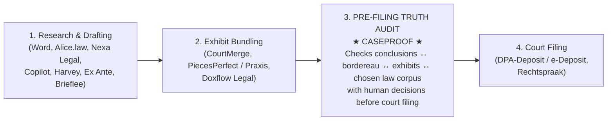

# CaseProof — Product Strategy & Competitive Blueprint (24 November 2026)

**Status:** Authoritative product strategy and competitive positioning document, adopted under [ADR 0038](adr/0038-pre-filing-truth-layer-and-competitive-strategy.md).  
**Reconciles:** Owner product framing (*Direction produit et parcours avocat*, 23 November 2026), verified competitive synthesis across 28+ market tools/references (24 November 2026), [ADR 0018](adr/0018-pre-submission-verification-freeze.md), [ADR 0019](adr/0019-evidence-engine-and-first-market.md), [M0–M6 Roadmap](ROADMAP.md), [Product Workflow](PRODUCT_WORKFLOW.md), [Offline Legal Corpus Pilot](OFFLINE_LEGAL_CORPUS_PILOT.md), and [Frontend Blueprint](../frontend/BLUEPRINT.md).  
**Boundary:** This is a product strategy and scope-alignment specification—**not** a claim of completed pilot validation, client-data authorization, legal/bar certification, or production release. All M5 and [SEC-01–16](security/PILOT_DATA_SECURITY_GATE.md) gates remain binding.

---

## 1. Strategic Positioning in the Belgian Litigation Stack

CaseProof is the **independent pre-filing truth audit layer** for Belgian FR/NL civil and commercial litigation conclusions.

Mapping the real Benelux litigation workflow reveals a distinct step between drafting/bundling and court submission:

- **Step 1 — Drafting & research tools** (*Word, Alice.law, Nexa Legal, Harvey, Microsoft Copilot, Legora, Ex Ante, Brieflee, Ordalie*) help lawyers research and generate prose—yet human and AI drafts alike still misstate page numbers, drop statutory opening reservations, reformulate `"envoyé pour signature"` into `"signé"`, misquote figures, or cite superseded legal versions.
- **Step 2 — Exhibit bundling tools** (*CourtMerge, PiecesPerfect/Praxis, Doxflow Legal*) merge PDFs, stamp piece numbers, and build a clickable table of contents—they focus on **assembling** the *farde de pièces / stukkenbundel*, not auditing whether sentence 42 of the *conclusions* matches page 4 of *Pièce 1*.
- **Step 3 — CaseProof's wedge:** an **independent, deterministic, post-assembly pre-filing audit** that checks conclusions—**whether drafted by hand or with AI**—against the confirmed bordereau, preserved original exhibits, and (when enabled) a pinned, versioned Belgian legal corpus.
- **Customer-facing promise:** *"Before filing, CaseProof checks detected references and assertions against the bundle and corpus you supply, shows exact mismatches and verification limits beside original source pages, and records your review for the exact version of your conclusions."* Never promise "100% accuracy", "every reference", "as filed", or a global verified certificate.

---

## 2. Scope Architecture: Pilot Core vs. Target Extensions vs. Non-Goals

This table reconciles the 28/31 October freeze with the 23 November product framing and active engineering:

| Track | Capabilities | Lawyer Outcome & Invariant |
| --- | --- | --- |
| **Pilot Core** *(First commercial proof)* | **1. Brief ↔ Bordereau ↔ Exhibit reconciliation** **2. Quoted passage & typed value checks** **3. Visible coverage & omission signaling** **4. Source-bound human decisions** **5. Word round-trip recheck & cold-reopenable export** | Identify `Pièce` / `Stuk` references; reconcile **3 separate page spaces** (`pdf_page`, `printed_page`, `bundle_page`); show exact source pixels/crops with OCR abstention; expose unscanned DOCX regions and let the lawyer flag an `omission`; record `Confirm / Qualify / Reject / Waive` without erasing machine findings; re-upload corrected Word `.docx`, carry forward unchanged findings, reopen changed ones, and export a tamper-evident trace. |
| **Target Extensions** *(In active engineering, subordinate to Pilot Core)* | **6. Versioned offline Belgian legal corpus** **7. Distortion & subtle-trap detectors** **8. Lawyer-defined conditions** (*conditions définies par l'avocat*) | Compare cited Belgian statutory articles against a user-selected, content-addressed FR/NL pack (Justel/ELI/Moniteur provenance), strictly refusing missing historical versions (`UNDETERMINED / requested_version_absent_from_chosen_corpus`). Surface verifiable assertions beyond explicit tags, omitted opening reservations (*« Hormis les cas… »*), dropped negations, status shifts (`"signé"` vs `"envoyé pour signature"`), and FR↔NL translation alerts. Apply explicit dossier conditions (e.g., proof of receipt of a *mise en demeure*) and route interpretation to human appraisal. |
| **Explicit Non-Goals** *("Refuse to Build")* | ❌ AI brief drafting / argument generation ❌ PDF bundle merging / tab stamping ❌ General Belgian case-law search engine ❌ Court e-Filing (DPA / e-Deposit / Rechtspraak) ❌ AGPL-3.0 code vendoring ❌ Qualified-signature / *constat* claims / global green badge | Let Alice, Nexa, Harvey, and Copilot compete on drafting—CaseProof audits their output neutrally. Let CourtMerge / PiecesPerfect / Doxflow merge bundles—CaseProof reads their pagination cleanly. Never claim a SHA-256 manifest is a qualified lawyer signature or *constat d'huissier*. |

---

## 3. The 7 Core Product Pillars

Every engineering sprint on CaseProof must strengthen at least one of these seven capabilities:

1. **Deterministic "No-LLM Verdict" Core** *(validated against CiteProof, VeriLeges, and ADR 0011/0018)*  
   Zero generative LLM in deciding `PASS / FAIL / UNVERIFIED / UNDETERMINED` or the four backend dimensions. Every check is byte-hashed, deterministic, reproducible, and explainable down to exact character spans and page geometry. Any optional future AI note is off by default and can never promote an uncertain or failing result.
2. **4-State Epistemic Dashboard over 4 Independent Dimensions** *(validated against Sentinel Citation and 23 Nov framing)*  
   The backend maintains four strictly independent dimensions (`exhibit identity`, `page location`, `text/value fidelity`, `human semantic support`). The lawyer cockpit groups action triage into four honest visible states—never collapsing them into one global green seal (see Section 4).
3. **3-Space Page Reconciliation** *(specifically engineered for CourtMerge / PiecesPerfect / Doxflow bundle handoffs)*  
   Tracks physical `PDF page`, original `Printed page`, and compiled `Bundle page` independently so renumbered court bundles, coversheets, Roman numerals, and annexes never cause silent mis-citations.
4. **3-Pane Instant-Snap React Cockpit + Live PDF Pixels** *(patterns from Clearbrief, Legora, and OpenContracts)*  
   Left exception-first review queue | Center conclusions excerpt + exact diff/reason + inline human decision (`Confirm / Qualify / Reject / Waive / Omission`) | Right live `pdfjs-dist` source canvas above the fold with non-obscuring bounding boxes and click-to-jump navigation from any finding, exhibit, or article row.
5. **Distortion, Subtle-Trap, and Lawyer-Condition Detectors** *(patterns from BriefCatch RealityCheck, Bewijslijn, and Harvey Playbooks)*  
   Detects omitted opening reservations, dropped negations, event/status reformulations (`"Le contrat a été signé le 12 mars"` vs `"envoyé pour signature le 12 mars"`), same-role Belgian Decimal/date mismatches, cross-language `FR ↔ NL` quotes (`TRANSLATION_REVIEW_REQUIRED`), and structured dossier-specific **Lawyer-Defined Conditions**.
6. **Versioned Offline Belgian Legal Corpus** *(patterns from LawCodex/be, Justel/ELI/Moniteur, and VeriLeges)*  
   Content-addressed, append-only FR/NL statutory packs with explicit ELI, Moniteur publication dates, and source digests that execute **with Internet disconnected**—no `"latest"` alias, no silent live scraping, and strict fail-closed abstention (`requested_version_absent_from_chosen_corpus`) when a requested historical version is absent.
7. **Word Round-Trip Recheck & Cold-Reopenable Diligence Export** *(patterns from Clearbrief Cite Check Report, Ironclad/LegalOn, and CiteProof)*  
   Lawyer edits `.docx` natively in Word → re-uploads → CaseProof shows exact changes, **carries forward** untouched decisions (`carried`), **reopens** changed/affected items (`superseded` / *À recontrôler*), and produces a self-contained, cold-reopenable, SHA-256-indexed **Pre-Filing Verification Trace** (JSON / HTML / Markdown / reviewed DOCX appendix).

---

## 4. Visible Lawyer Taxonomy vs. Backend Verification Contract

To keep the UI immediately legible for Belgian litigators while preserving strict backend invariants (UI-01..UI-10, ADR 0018/0022), every finding displays both its clear lawyer-facing state and its exact underlying dimension/reason:

| Visible Lawyer State (FR / NL / EN) | Visual Signal | Operational Meaning | Underlying Backend Mapping |
| --- | --- | --- | --- |
| **Écart constaté** / **Afwijking vastgesteld** / **Mismatch detected** | Crimson `✕` (never color alone) | Deterministic comparison identified a concrete mismatch (wrong page, altered quote, omitted reservation, conflicting value, absent confirmed exhibit). | `FAIL`, `MISMATCH`, `CONFLICTING`, `NOT_IN_INVENTORY` (confirmed scope) |
| **Contrôle impossible** / **Controle onmogelijk** / **Cannot verify** | Dashed slate `⊘` | Source missing, unreadable scan (`OCR_UNRELIABLE`), unmapped page, unconfirmed inventory, or requested historical statutory version absent from chosen corpus. Exact reason stays visible. | `UNVERIFIED`, `UNDETERMINED`, `SOURCE_MISSING`, `UNMAPPED`, `OCR_UNRELIABLE`, `NOT_ASSESSED` |
| **Appréciation requise** / **Beoordeling vereist** / **Appraisal required** | Ochre `!` | Source passage is located and readable, but legal scope, paraphrase, translation (`FR ↔ NL`), subtle event distinction (`"signé"` vs `"envoyé pour signature"`), or a lawyer-defined condition requires human decision. | `TRANSLATION_REVIEW_REQUIRED`, subtle-trap/condition review triggers, `semantic_support = NOT_ASSESSED` |
| **Correspondance constatée** / **Overeenstemming vastgesteld** / **Match observed** | Teal `✓` | Checked item matches the preserved source within the declared scope. **Does not** imply authenticity, filing, or legal adequacy. | `PASS`, `RESOLVED` + `MAPPED` + `EXACT_MATCH` |

In addition, **Coverage** is always rendered separately (DOCX story regions scanned/unprocessed/unsupported, unreadable pages, corpus selection hash), and lawyers can explicitly log an **`omission`** when a passage was missed by automated detection.

---

## 5. Verified Competitive & Reference Landscape (28+ Tools)

**Discipline (ADR 0018/0019):** Observations below reflect verified product positioning as of November 2026 and serve as design inputs and benchmark hypotheses—**never** as claims of market exclusivity or untested competitor inability. Direct workflow testing during M5 remains required.

### 5.1 Verification & Anti-Hallucination Peers
| Tool / Concept | Observed Role | Pattern Adopted by CaseProof | Pattern Rejected / Guardrail |
| --- | --- | --- | --- |
| **Clearbrief** | Word add-in + portal: factual/legal cite checking, highlighted source view, hyperlinked PDFs & Cite Check Report. | Click-to-jump PDF highlight beside the sentence; partner-ready diligence report export. | Word-mandatory launch (keep web cockpit first; Word add-in deferred to M6). |
| **BriefCatch + RealityCheck** | Word writing polish + RealityCheck citation/quote/proposition check. | Omitted reservation & distortion detection (e.g., dropped opening qualifiers/negations). | Grammar/style coaching (distracts from evidentiary accuracy). |
| **CiteProof** | Deterministic brief cite-checker isolating LLMs from source records for Rule 11 "reasonable inquiry" audit trails. | Strict deterministic isolation ("no LLM in verification verdicts") + professional diligence framing. | US-only CourtListener / Rule 11 framing. |
| **Sentinel Citation** *(CiteSentinel)* | Multi-model jury testing existence, quote accuracy, and holding support. | Separating existence, literal fidelity, and human scope/support cleanly. | Sending confidential client briefs to a multi-LLM jury. |
| **VeriLeges** *(Softron, NL)* | Dutch rule-based checker for ECLI & statutory references against `wetten.overheid.nl` & `Rechtspraak.nl`. | Fixed deterministic European civil-law parser (FR/NL `Art.`, `Loi`, `Wet`, `NUMAC`, `ECLI`) aligned with bar guidance (OVB / Avocats.be / NOvA). | Live unpinned web scraping at check time (use versioned offline packs instead). |
| **QEL / Constat / Argus** *(Concepts / domain terms)* | QEL: cryptographic evidence sealing; Constat: bailiff/electronic evidence certification; Argus: monitoring concept. | Tamper-evident SHA-256 export manifest tying brief hash, source/corpus hashes, and timestamped human decisions. | **Never** call a SHA-256 hash a qualified signature or *constat d'huissier*. |

### 5.2 Belgium / Netherlands & Adjacent Litigation Stack
| Tool | Region & Core Job | Lesson for CaseProof | Differentiation Hypothesis (to Benchmark in M5) |
| --- | --- | --- | --- |
| **CourtMerge** & **PiecesPerfect** *(Praxis)* | **BE/NL:** Local-first PDF exhibit bundling (*stukkenbundels*), stamping, clickable TOC (CourtMerge ~€149 one-time; PiecesPerfect in Praxis). | Respect Belgian local-first confidentiality expectations; ingest stamped bundles cleanly via 3-space pagination (`PDF` / `Printed` / `Bundle`). | Complementary, not competing: CaseProof audits conclusions **against** the merged bundle. |
| **Doxflow Legal** | **NL:** Procedural bundling, tabs, Zivver, direct *Rechtspraak* filing, DMS links. | Understand procedural binder handoff (*processtukken* vs exhibits). | Do not build print-shop or e-Filing in v1. |
| **Alice.law** *(Ghent)* & **Nexa Legal** *(Antwerp)* | **BE/NL:** Litigation AI workspaces / Word case assistants drafting arguments, defenses (*exceptio*), and conclusions. | Native FR/NL Belgian legal UX; position CaseProof explicitly as the **independent check on human OR AI-drafted conclusions**. | Neutral auditor—lawyers should not rely on the drafting AI to audit itself. |
| **Bewijslijn** | **NL:** Dossier timelines & source-verified facts (*refuses to speculate on unmentioned facts*), EU hosting. | Source-provenance fact cards & explicit Lawyer Conditions backed by exact page excerpts. | Deterministic quote/value checks + human appraisal rather than opaque LLM timelines. |
| **LEGALFLY** | **BE/EU:** Enterprise legal OS in Office with strict anonymization & sovereign trust posture. | Transparent local/EU data-boundary disclosure without claiming "zero risk". | Focused litigation pre-filing audit vs broad corporate contract OS. |
| **Ordalie / Brieflee / Ex Ante** | **FR/BE:** Legal research, meeting transcription (Brieflee), Belgian legislative/case-law search (Ex Ante). | Direct ELI / NUMAC / Moniteur belge provenance links beside cited articles. | Do not build general legal search or meeting transcription. |
| **INDICA** | **NL:** Enterprise-scale eDiscovery across massive datasets. | Fast keyword/value lookup inside uploaded exhibit PDFs. | CaseProof targets the final 50–200-page litigation dossier, not million-doc eDiscovery. |
| **Doctrine Flow Litigate / Wolters Kluwer InView (Libra) / Jimini / QiXCite** | **FR/BE/EU:** Drafting, exhibit organization, research, and Word verification workflows. | Benchmark directly during M5 on actual post-assembly exhibit/page accuracy, OCR abstention, and total checking time. | Precision of Belgian 3-space pagination, offline pinned corpus, and transparent epistemic states. |

### 5.3 Global Legal Platforms (UX Patterns to Borrow)
| Platform | Pattern Adopted | CaseProof Translation |
| --- | --- | --- |
| **Harvey** *(Vault / Threads)* | Structured Playbooks + exception-first review queues + explicit privileged-workspace cues. | **Lawyer-Defined Conditions** (*conditions définies par l'avocat*) as structured litigation check playbooks. |
| **Legora** *(incl. Qura)* | Tabular review matrix with instant right-hand PDF source snapping. | Clicking any row in Findings, Exhibits, or Legal Articles snaps `SourceViewer` straight to the target PDF page or statutory text. |
| **LegalOn & Ironclad** | Side-by-side `<del>`/`<ins>` diff + strict state invalidation across revisions. | Word re-upload highlights exact changes, preserves `carried` decisions, and marks modified items `superseded` (*À recontrôler*). |
| **Microsoft Copilot** | Zero-friction Word workflow. | Keep native Word editing + instant `.docx` re-upload frictionless without making an Office add-in a launch blocker. |

### 5.4 Infrastructure & Open-Source References
| Reference | Safe Usage in CaseProof | Hard Guardrail |
| --- | --- | --- |
| **OpenContracts** *(MIT/Apache)* | Reference architecture for PDF bounding-box overlays, coordinate anchoring, and corpus UI. | Keep CaseProof's strict `pdfjs-dist` worker/memory lifecycle and contract validation (`frontend/BLUEPRINT.md`). |
| **Mike OSS** *(AGPL-3.0)* | Study BYOK/local-sovereignty UX, partial-failure recovery, and citation-grid ergonomics conceptually. | **NEVER copy or vendor AGPL-3.0 source code** into proprietary CaseProof. |
| **LawCodex/be + Justel + Moniteur + snowLEX + LexCodex** | Use LawCodex/be for FR/NL statutory structure discovery, verified against official Justel/ELI/Moniteur captures; follow snowLEX's source-grounded graph discipline. | LawCodex is a current snapshot only; never claim complete legislative history or redistribute restricted multimedia without rights (`OFFLINE_LEGAL_CORPUS_PILOT.md`). |
| **Westlaw / LexisNexis** | Unmistakable visual status hierarchy (Good / Caution / Mismatch). | Never scrape proprietary databases or claim legal validity/good-law status. |

---

## 6. Single Official UI Lock & Immediate Delivery Sequence

To prevent fragmented UX across prototypes, this strategy locks one product interface:

- **Official Product UI:** `frontend/` (React 19 + strict TypeScript + `pdfjs-dist`, FR/NL/EN, 2026 legal-grade tokens and 3-pane cockpit). Governed exclusively by [frontend/BLUEPRINT.md](../frontend/BLUEPRINT.md).
- **Offline Engine Harness (non-product UI):** `scripts/serve_offline_legal_workbench.py` remains a local loopback developer/engine harness for disconnected offline corpus testing.
- **Historical Prototypes:** `apps/web/*` remain compatibility/regression references only.

### Immediate Product-Shaped Delivery Bridge (Pre-Pilot)
1. **Unify the React 3-pane cockpit (`frontend/`):** Ensure `ExhibitsSection`, `PackDownload`, `omission` logging, `ConditionsSection`, and `LegalScreen` all share the same FR/NL/EN 2026 visual language, accessible status taxonomy, and instant-snap `SourceViewer`.
2. **Surface subtle-trap & lawyer-condition checks inside the official cockpit:** Bring `"signé"` vs `"envoyé pour signature"`, omitted-reservation highlights, and dossier-defined lawyer conditions from the offline engine into the canonical API contract and React UI (never duplicating verification logic in React).
3. **Complete signed M1–M4 browser & export acceptance:** Real-format synthetic FR/NL DOCX + inventory + text/scanned PDF + pinned legal pack → review/omission/correction → Word round-trip recheck → cold-reopenable export verification.
4. **Evaluate deployment & security in parallel:** Complete field-level data-flow/egress mapping (local/firm-controlled vs hybrid vs hosted) and [SEC-01–16](security/PILOT_DATA_SECURITY_GATE.md) before touching any real client dossier.

---

## 7. Commercial Validation & Pilot Proof Protocol (M5 Alignment)

All M5 rules and [P5-01..04 prerequisites](ROADMAP.md#pre-m5-hard-prerequisites--the-commercial-experiment-must-have-an-exit) remain binding.

### 7.1 Mandatory Partner Demo Scenario (Synthetic / Rights-Cleared First)
Before asking a Belgian firm to evaluate a pilot, demonstrate one end-to-end journey containing:
1. A factual reference pointing to the **wrong page** in a multi-space stamped bundle (`PDF` ≠ `Printed` ≠ `Bundle`).
2. A legal or factual quotation with an **omitted opening reservation** (*« Hormis les cas… »*) or altered qualifier.
3. A subtle status reformulation (**`"Le contrat a été signé le 12 mars"`** vs source **`"envoyé pour signature le 12 mars"`**) surfaced for human appraisal beside the original page.
4. A **lawyer-defined condition** (e.g., proof of receipt of a *mise en demeure*) and an explicit **`omission`** record.
5. **Word round-trip correction & recheck:** fix in Word → re-upload → untouched decisions carry over (`carried`), modified items reopen (`À recontrôler`) → export a self-contained, cold-reopenable verification trace.

### 7.2 Pilot Benchmark Metrics (3–5 Representative FR & NL Dossiers)
Once [SEC-01–16](security/PILOT_DATA_SECURITY_GATE.md) and data rights are approved for the target environment, benchmark 3–5 representative FR and NL dossiers (including both human-drafted and AI-assisted conclusions) against the firm's current manual review on three concrete metrics:
1. **Total end-to-end review time** (upload + inventory confirmation + OCR + review + Word correction + recheck + export vs. baseline manual checking).
2. **Critical errors caught vs. missed** (against independent two-lawyer ground truth, with `0/N` confidently wrong matches/maps as a mandatory safety trigger for root-cause analysis).
3. **False-alarm rate and review friction** (proportion of surfaced alerts that waste partner/associate time vs. honest, useful abstentions).

Outcome follows P5-01 strictly: **PROCEED** (bounded paid design-partner beta proposal), **REFINE** (targeted M1–M4 fix and rerun), or **RECONSIDER** (halt niche pending owner decision).
