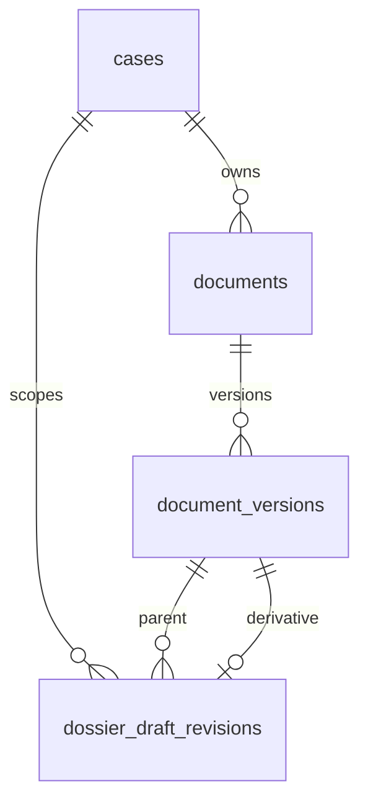

# Dossier draft revision persistence — implementation proposal

This is an uninstalled schema proposal, not live acceptance.

The correction record uses existing organization-scoped case, document and version
keys. It never introduces a second evidence identity. The command key is scoped to
organization, case and signed actor; a changed command under the same key must
conflict. The partial unique index prevents two activated children of the same
parent. Pending versions must not change the current bundle signature.

Runtime users have no direct access to the correction table. Reservation and
activation require current organization actions and matter grants. Activation must
be restricted to the trusted server after verifying the signed actor and freshly
reading the exact private Storage version. A signed caller may never self-certify
an upload by supplying a digest. The server's readback checks both size and SHA.

Reservation, new document version and reservation audit belong in one transaction.
The external upload runs outside SQL transactions. Activation, parent CAS, active
bundle pointer and activation audit belong in another transaction. Retry after an
unknown upload acknowledgement must reconcile by authorized exact-byte readback.
An activation retry returns the original receipt; an audit failure rolls back the
active pointer. A failed reservation remains inactive and eligible for scoped
cleanup. Prior originals and snapshots remain immutable.

The active bundle manifest and all signature producers/readers must switch together.
A pending revision must leave the old signature unchanged. Activation changes the
signature, invalidates old review dependencies and requires a new canonical check.
A historical report remains a historical record; it cannot authorize the new draft.

Before installation, test cross-tenant references, revoked actors, direct table and
activation denial, concurrent child activation, audit rollback, upload interruption,
changed idempotency command, process restart, unchanged source bytes and recheck.
No rollback may delete preserved originals. Disable activation before any recovery;
retain revision rows and receipts for inspection. Live migration requires review.
