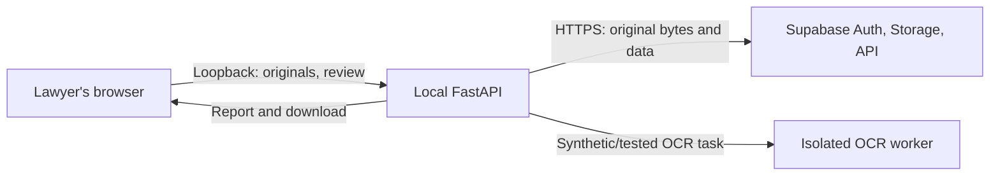

# CaseProof pilot data flow — signed development configuration

**Purpose:** A short architecture note for a prospective design partner's IT, privacy and risk review. This describes the implemented signed development journey tested in [PR #182](https://github.com/haytamAroui/caseproof/pull/182), not an approved production deployment or an offline installer. Before any pilot with real client files, identify the actual build, provider/region, operator, contractual terms and retention schedule and have the appropriate parties review them.

**Browser and local API.** The Vite/React workspace is served by FastAPI on loopback in the tested setup. The browser sends selected draft, inventory and exhibit bytes to that local API. The workspace response sets a strict Content Security Policy, including `script-src 'self'` and `connect-src 'self'`; the browser restriction is enforced in the **HTTP response header**, not a claim about all network traffic. The API rejects non-loopback requests. See `apps/api/litigation_development_app.py` and `tests/test_workspace_auth.py`.

**Outbound services.** The local API calls the configured Supabase project's Auth, PostgREST and private Storage APIs over HTTPS/TLS (normally TCP 443), using the signed-user flow and scoped authorization. The intake service sends **original document bytes** to private Storage and performs authorized byte readback; report, review, source metadata and processing-related data can also be sent to or retrieved from the backend. Therefore, **the current signed development configuration does not keep all document content on the local machine**. It must not be presented as offline or zero-egress. Port 5432 is not the demonstrated browser-to-Supabase or application HTTP path; a direct PostgreSQL connection, if added in another deployment, needs its own documented configuration. See `apps/api/workspace_intake.py`, `apps/api/signed_supabase_originals.py`, `apps/api/workspace_auth.py` and `apps/api/litigation_live_journey.py`.

**OCR and evidence.** OCR in the tested configuration uses an isolated worker. The [synthetic OCR network capture](https://github.com/haytamAroui/caseproof/actions/runs/41666612265) observed its loopback control, no non-loopback packets in that worker namespace and a denied synthetic outbound attempt. This is worker-scoped evidence; it does not measure the browser, API, Supabase, DNS or an entire deployment. The signed browser journey and zero-residual synthetic fixture cleanup passed in [run 41673300733](https://github.com/haytamAroui/caseproof/actions/runs/41673300733). Neither result substitutes for a whole-deployment assessment.

**Design-partner review.** The firm may review the chosen pilot architecture, provider/region, access and revocation, retention/deletion and backups, permitted data, incident response and applicable data-processing agreement, then perform its own technical checks and record its decision. Its review is independent only when actually performed and accepted by the relevant people. No firm, reviewer, signed agreement, provider region or retention term is represented as agreed here. If the pilot requires document content never to leave the firm's perimeter, that requires a separately specified and tested deployment rather than the Supabase-backed development flow described above.

Further details: [deployment evidence runbook](DEPLOYMENT_EVIDENCE_RUNBOOK.md), [retention design](RETENTION_DESIGN.md) and [security gate](PILOT_DATA_SECURITY_GATE.md).
