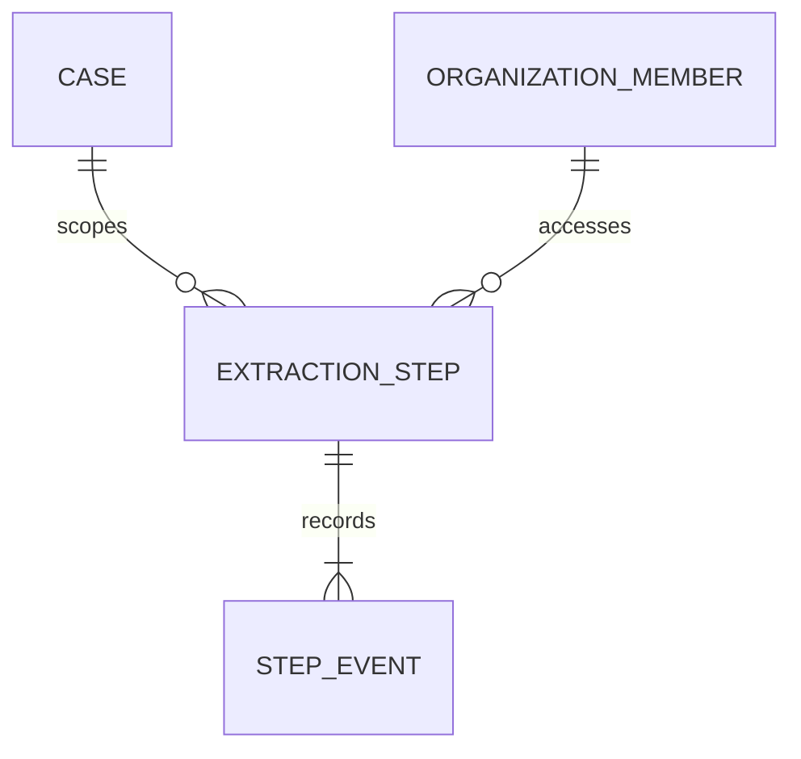

# EI-001 — integrated Evidence Intelligence candidate runtime

Authorized scope: owner requested one combined milestone adapting AZComply's paid extraction patterns, a sector-neutral Kernel, finance plus thin construction observations, and **Requesty only**. Independent implementation; no AZComply code copied. Base: `6e8290faa638f3d1159add37e52a3558a870a7ba`. Branch: `feat/evidence-intelligence-v1`.

## Disposable persistence design (review specification)

Composite `(org_id, case_id, run_id, step_id)` is the step primary key and event foreign key. Case foreign key is `(org_id, case_id)`. Events append a unique revision per step. The primary keys cover scoped reads, CAS and parent references; the actor FK index supports membership lifecycle checks. No JSONB fact authority: payload text is a bounded raw response or reproducible candidate projection, not a decision.

This proposal is isolated to `db/proposals/`, installed only by disposable CI. RLS is enabled and all API/public grants revoked; no runtime policy or live identity binding is installed. The test adapter uses an isolated database owner and **synthetic actor UUID**, checks/locks active membership with `case:read` and `finding:write` on every transaction, and never claims that this is signed Auth or least-privilege production access. No public route exposes it.

Reserve/checkpoint CAS and append-only event insertion share one transaction. The provider call is outside transactions. Dispatch is committed first; received raw response is committed before parsing. Crash after dispatch without response stays outcome unknown; retries never redispatch. Saved responses replay through the same pinned checks. Changed source hashes, representation/parser/config/policy/model/prompt reject reuse. Unknown database commit outcome is reconciled by reading the step on next invocation, not overwriting it.

Recovery: rerun against same source manifest, run ID and journal; inspect uncertain steps manually. There is no automatic unknown-to-prepared reset. Drop the disposable database to roll back the proposal; do not run DROP against live services. No canonical migration, credentials, grants, production deployment or customer data changes.

## Acceptance and limitations

Exact source/entity/slot checks, visible rejected proposals, no confidence promotion, negation/conditional review, unknown signals review-only, bounded topologies and targeted repair, contradiction ledger, Kernel finding/link/coverage projection, restart and concurrency tests, Requesty HTTP envelope tests. Every output remains unapproved and semantic sufficiency unassessed. Four-pass is opt-in experimental discovery, never independent verification or a benchmark claim. Inputs are existing immutable UTF-8 representations; PDF/OCR/XML/email parsing, authenticated reviewer UI and production durable graph remain separate gates.

Local commands (exit 0): `uv run --locked pytest -q` (988 tests); `uv run --locked ruff check .`; strict mypy on all nine new runtime/adapter/domain modules; `uv run --locked python scripts/check_architecture.py`; `python -m compileall`; offline synthetic finance/construction demo. A pre-existing Starlette/httpx deprecation warning remains. The final CI suite count and cloud results belong to the PR checks.

Seven new real PostgreSQL scenarios are wired into CI; PostgreSQL is not installed in this local workspace. These are integration tests with scripted provider responses, not live inference. No live Requesty quality baseline has been measured. Independent human review and production gates remain open; self-review is not an independent authorization attestation.
