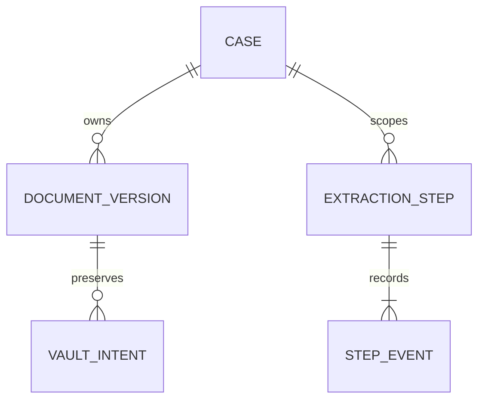

# EI-002 — document intake to Requesty extraction (combined PR)

Owner instruction: build one combined PR for document intake/parsing and extraction evaluation. Branch `feat/document-intake-extraction` is stacked on **open PR #53**, commit `26b2946e2775045eed5372b9c05a72372d2ddf85`; PR #53 is not silently merged or represented as independently approved.

## Persistence/access review

No new tables or canonical migrations. Existing disposable `_ei_steps`/`_ei_events` persist bounded normalization artifacts or explicit failure dispositions; immutable input fingerprints include source/version/hash/media/parser and investigation inputs. Source manifest links are serialized provenance, **not new relational foreign keys or a complete durable Kernel graph**. The existing scoped primary keys/indexes/CAS/event transaction remain unchanged. Pure parsing can retry before checkpoint capture; saved successful or failed parsing is replayed. No provider call occurs if a required source is incomplete/unprocessed. Existing extraction dispatch/unknown-outcome rules remain in force.

The only SQL change extends the **disposable** Vault proposal's MIME checks with `message/rfc822`; the internal Vault protocol allowlist matches it. No public/anonymous/authenticated grant, RLS policy, source lifecycle authority or deployed bucket changes. Disposable owner-connection tests and synthetic identity are not production Auth/least-privilege proof.

The internal adapter resolves bearer case access via existing verifier/repository ports, requires `case:read`, `evidence:read`, `finding:write`, takes source records from a trusted server catalog, reads exact Vault bytes, and rechecks access/inventory/availability before return. It accepts no caller tenant/role. This is a best-effort read/proposal snapshot, not an atomic approval. No HTTP route is added. Real signed sessions and runtime DB identity remain existing production gates.

## Implemented outcome and limits

- Text PDF pages → exact parsed text spans plus physical page index. No fabricated glyph boxes. Blank/image/form/active/truncated/unsupported content is rejected or incomplete; **no OCR engine** is added.
- XML/UBL → namespace-aware indexed element/attribute paths and Kernel-native structured scalar projection. Defused XML disallows DTDs/entities/external references; UTF-8/depth/node/output limits apply. Generic XML normalization is not XSD/Peppol business validation.
- RFC5322/MIME email → decoded headers/plain body with MIME-part IDs, original bytes retained. Headers are claims, never sender authentication. HTML, attachments, unknown charsets and defects are explicit incomplete states; links are never fetched. No inbound mailbox, sender action, reply or webhook.
- Linux subprocess limits: 5 MiB original, 120k text codepoints, 64 PDF pages, 2048 blocks, bounded XML/MIME nesting, 5 CPU seconds, 8-second default wall timeout, 384 MiB address space, bounded output and descriptor count. Credentials/proxy settings are absent from child environment. Resource limits **are not an OS malware sandbox/scanner**; no public upload route is enabled.
- Existing Decimal invoice/PO comparison consumes exact normalized UBL fields and native scalar citations; outcomes remain unapproved candidates.
- Four synthetic labeled files evaluate anchor resolution, strict label matches, negative false validation, elapsed time and provider-reported usage/cost. Default scripted run explicitly does not measure live model quality. Live Requesty mode is opt-in, repository corpus only, maximum 8 calls × 512 output tokens, no repair/retry/fallback, and requires an existing guarded disposable Postgres journal and stable run ID. No key/model is configured in this workspace, so live quality/cost remain **not measured**.

## Validation/recovery plan

Unit/adversarial tests: PDF page/scan/active/encryption limits; XML entity/encoding/depth/duplicate-scalar cases; email MIME/HTML/charset/ambiguity; source changes; auth/revocation/stale snapshot; parser replay and canonical field citations. Real PostgreSQL/private-filesystem integration: one case with PDF/XML/email originals, source hash checks, separate-process no-parser/no-provider replay, foreign/revoked identity, corrupt originals, normalization event rollback and incomplete email blocking. Existing CI checks are retained; new strict type checks and integration command are additive.

Revert the additive intake/parser/evaluation modules and MIME reference extension to roll back. Dispose only the ephemeral test DB; no production data or parser representation is overwritten. Performance/accuracy targets and independent review remain unclaimed until measured/reviewed. Actual commands/results and cloud links are recorded on the PR after execution.

Local verification before the combined CI batch: `uv run --locked pytest -q` passed **1,036 tests**; Ruff, architecture checker, strict mypy on 13 new intake/parser/evaluation files plus both existing groups passed. Python compilation and offline synthetic evaluation passed; PDF fixture was rendered and visually inspected. PostgreSQL is not installed locally, so the six new real DB/Vault scenarios are execution-pending until CI. Existing Starlette/httpx deprecation warning remains. No live provider quality score or measured model cost is asserted.
