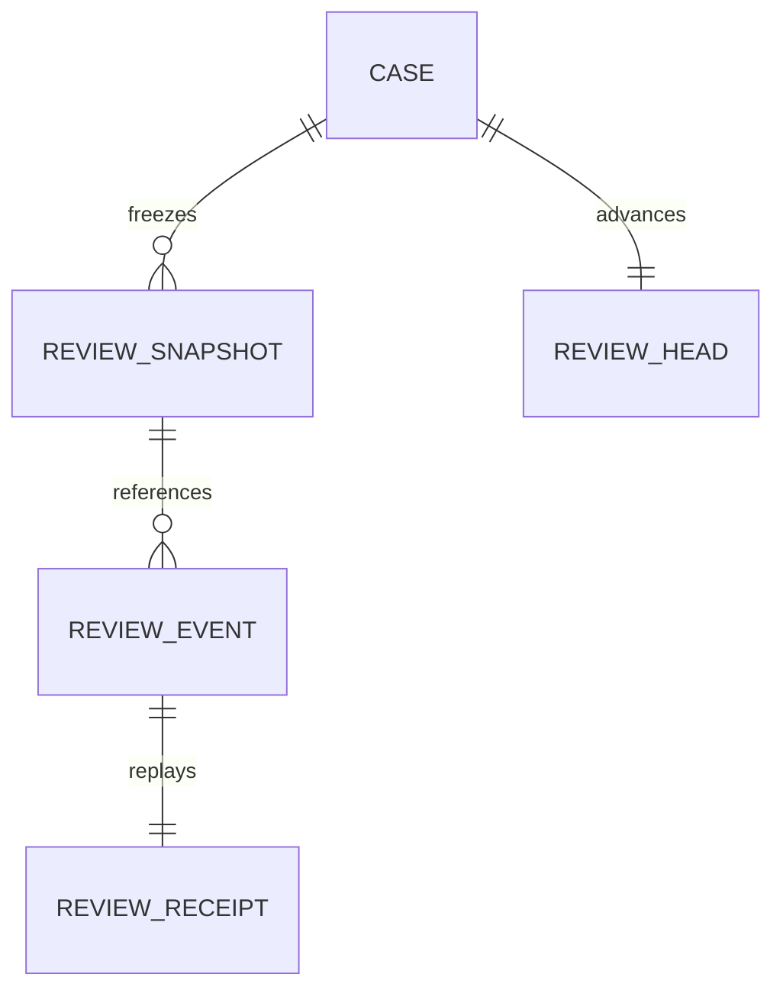

# EI-003 — reviewer workbench and integrity-verifiable draft pack

Branch `feat/reviewer-resolution-pack`, stacked on open PR #54 at `7cff7a211a72b348103b86e76c372c4283146d1a`. No prerequisite is silently merged. The owner's instruction authorizes the combined implementation, not live migrations or deployment.

## Authority and scope

Installed `review:request` permits review **proposals**, not approval/disposition authority (ADR 0011 and action_catalog.v1.json). Record retain/reject/correct/qualify/request-evidence recommendations against a frozen snapshot; never change Kernel evidence, source truth, support, coverage completeness, payment or legal approval. No new permissions or production routes. The separate loopback synthetic workbench is visibly a demo, with a guarded in-memory reference or disposable PostgreSQL repository; synthetic identity is not genuine Auth.

## Disposable persistence review

Tenant/case composite keys and foreign keys scope every snapshot/head/event/receipt. Immutable snapshots bind original versions, representation/parser manifests, extraction/policy versions, conflicts and required slots. Events are append-only under runtime privileges; owner fixtures are not tamper-proof. Source originals remain in the existing Vault. No new authoritative facts table.

The disposable adapter checks active `case:read`, `evidence:read`, `coverage:read`, `review:request` membership in every transaction, locks membership/case/head, rejects stale source/case/snapshot/review revisions, then commits review event, audit chain/head and idempotency receipt atomically. Replays recheck current membership and exact request fingerprint; unknown acknowledgements are reconciled by stable request ID. Source-version/intents are checked against verified scoped Vault metadata when snapshotting/recording. Byte availability is independently rechecked by the application; this does not replace a production atomic export/approval snapshot.

RLS enabled; revoke public/anon/authenticated table grants, no new production policies/roles. Primary/unique indexes cover scoped heads, per-case revision, request key and snapshot references; actor FK indexes support membership access. SQL lives only in `db/proposals`. Rollback is disposal of the ephemeral CI database and reverting additive code, not a destructive live migration.

## UI and export

Refero research returned `NO_SUBSCRIPTION`; no reference screenshots were claimed. Use the existing finance-review prototype as primary identity evidence plus Refero craft/anti-slop references. Preserve petrol navigation, cool white work surfaces, source highlight amber only for evidence attention; compact case queue/detail/source/review/history layout, no marketing hero. DESIGN.md/UX-CONTRACT.md record ownership and behavior.

Export a **draft evidence/review pack**, not an approved conclusion: original bytes, normalized representation/mapping, frozen case data, review/audit history, readable HTML report and checksummed manifest. Offline verification checks every file and exact source citation; a separately retained manifest hash is needed to establish identity relative to an external checkpoint. Hash consistency is not authenticity, a qualified signature, legal validity or reviewer authorization. Never execute scripts or extract arbitrary paths from a pack.

## Required evidence

Unit/adversarial: stale sources/snapshots, cross-scope, unknown/duplicate commands, concurrency and audit failure, correction revisions, report injection, ZIP traversal/duplicates/bombs/tampering, Unicode citation highlighting. Real PostgreSQL: atomic head/event/receipt, revocation, races, rollback, restart and unknown commit outcomes. Browser: real UI save/correction/history/export, refresh, failures, keyboard, narrow viewport, unsaved drafts, conflict recovery and source highlighting. Existing CI gates retained; exact outcomes recorded on PR after execution.
