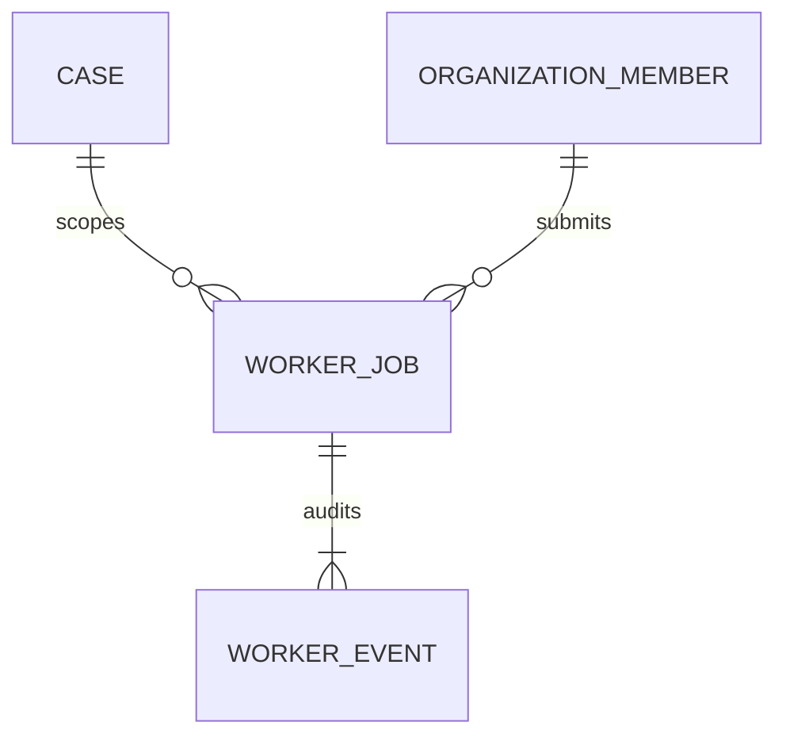

# EI-004 — durable extraction queue and worker recovery

Branch `feat/durable-extraction-worker`, base #55 `8ebcd60fd342ae09b9276520b2bafce47c62cee6`. All prerequisites stay open/unmerged unless separately instructed. [ADR 0015](../adr/0015-leased-document-jobs.md) records the execution/evidence boundary.

## Data/access review

Job PK `(org_id,case_id,request_id)` scopes immutable input fingerprint, submitting actor, bounded versioned source/plan JSON, typed execution state, attempts/revision, availability and lease metadata, bounded result JSON and digest. Composite case and membership FKs prevent cross-tenant parent identity. Events use the same scoped job key plus monotonic revision. Events are append-only through adapter operations; owner fixtures are not tamper-proof.

RLS enabled, revoke all PUBLIC/anon/authenticated grants, no policies/new installed roles. Scheduler authorizes existing case/evidence/finding actions using server-derived identity. Enqueue, claim, heartbeat, checkpoint and result writes verify current active member/actions, case/policy and source intent binding. Cancellation requires current membership/actions and the original actor but remains possible after sources/policy change. Internal expiry handling may mark an inaccessible job blocked/unknown but cannot execute it. Case/org IDs for claim come only from trusted scheduling. Client-visible reads require membership/actions and suppress stale result content while preserving execution history. No network route mounts these methods.

Transactions: enqueue + initial event; claim + attempt/token/revision + event; heartbeat + revision/event; finish + immutable result/hash + event; cancel + fence invalidation/event. Provider and parser calls never hold these transactions. Checkpoint adapter's queue fence and existing EI journal mutation share one transaction; do not implement fence with a separate check-then-write connection. Server `clock_timestamp()` governs expiry rather than worker clocks. Jobs preserve the same run IDs across recovery. An uncertain commit is reconciled from durable state.

Partial ready index `(org_id,case_id,available_at,created_at,request_id)` and expired index `(org_id,case_id,lease_until)` bound scoped polling; member FK index supports actor lookups. Job/event PKs cover scoped CAS, exact reads and ordered audit history. No global JSON GIN index or per-source N+1 query. Source-manifest metadata join locks matched version/intents during the transaction; actual Vault bytes are freshly read outside it.

## Recovery/acceptance

- Queued source references → real private synthetic bytes → parsers/extractor → frozen unapproved review result → existing review/draft-pack verifier.
- Two connections cannot own the same active lease; a locked job does not prevent claiming another job.
- Expired pre-dispatch work can resume; dispatched/unknown work stays unknown; stored replies replay without another model call, including a fresh process.
- Heartbeat renews within an immutable total deadline, cancellation fences, changed access/policy/source blocks, attempt exhaustion terminates, backoff prevents immediate polling retries. Deadline expiry preserves unknown dispatches.
- Event failure rolls back state, lease and result; lost commit acknowledgement returns the existing immutable result; tampering/cross-tenant access fails.

Test commands: `uv run --locked pytest -q`, affected strict mypy/Ruff, architecture checker, and `uv run --locked python -m scripts.verify_worker_integration` **after** existing disposable DB integrations. No production PG connection is permitted by the integration helper. Exact CI outcomes belong on the PR after execution; do not claim that scripted inference measures live model accuracy.

No canonical migration, secret, deployment, real Auth account or customer document changes. Forward migration needs independent review and actual runtime-role design; rollback is disposal of CI DB/reversion of additive code. Next join gate remains genuine private intake/Auth/DB and authorized human decision, followed by measured customer outcomes—not multi-agent expansion.
