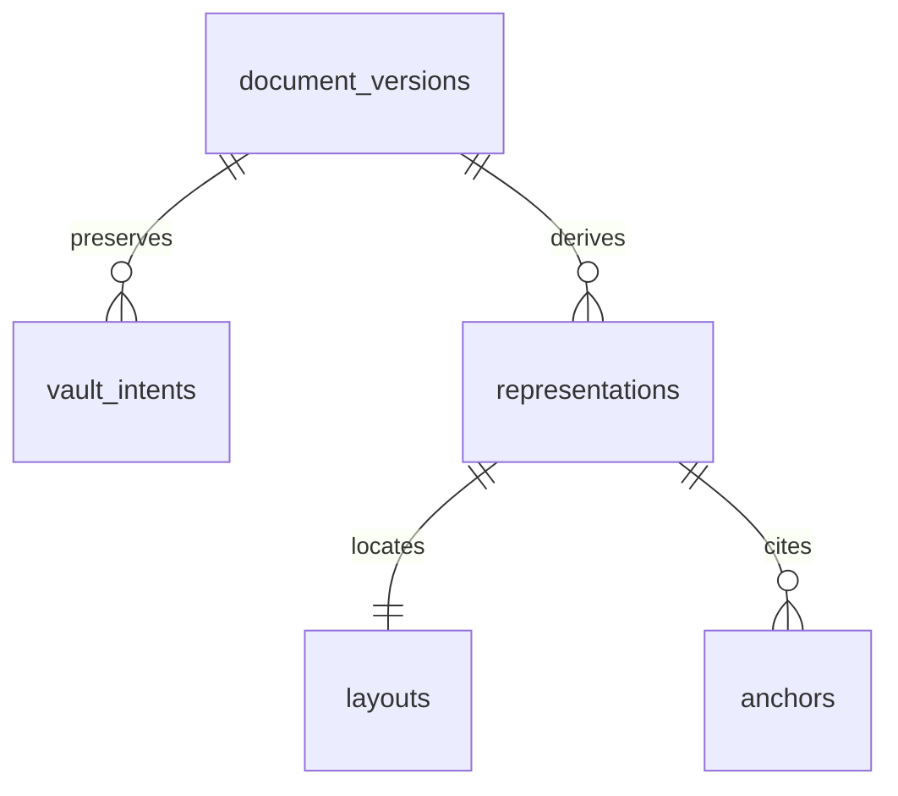

# TEXT-INT-001 — Exact persisted text evidence after process restart

## Goal and bounded implementation

Base `9dabe59a4ddeea2f9aaed9b4d83c32af67683099` includes merged PR #51:
real disposable PostgreSQL + private filesystem Vault integration. Resolve one
persisted, typed text anchor against actual preserved original bytes in a fresh
Python process, using the existing Kernel and metadata graph. No new source,
fact or approval authority is introduced.

`apps/api/disposable_text_evidence.py` composes the existing exact graph reader,
VaultCoordinator, KRN-101 source/representation constructors, locator codec and
KRN-103 fidelity evaluator. A per-read in-memory registry only hydrates these
immutable persisted records; it is neither durable storage nor another ledger.

## Parser contract

The first parser is `identity_utf8` version `1`, strict UTF-8 with normalization
`none`, versioned configuration SHA, and Unicode code-point half-open offsets.
Original and representation bytes are identical, deliberately stored ONCE in
the existing Vault. Whitespace, CRLF, combining characters and repeated quotes
are preserved. No fuzzy remapping or approximate normalized offsets exist.
Other parser versions, source formats and separately transformed bytes are
unsupported until an explicit immutable representation-byte binding is added.
No PDF/OCR/UBL extraction or model invocation is claimed by this increment.

## Existing data relationships



Names abbreviate existing disposable S2-008a/009b tables. Physical document/
version UUIDs and opaque Kernel IDs remain separate. Composite org/case/source/
representation/digest joins bind the chosen Vault intent to the exact anchor
parent. Equal-byte sources or parser representations never become substitutes.
Point lookups use existing primary/unique keys; no new schema or index is needed.

## Fixture persistence, access and recovery

Only `scripts/verify_text_anchor_integration.py` writes synthetic fixture
metadata to the existing ephemeral SQL proposals. Its transaction locks/bumps
the fixture case revision and appends an audit event plus source bindings,
representation, layout and anchor. Audit failure or duplicate-anchor insertion
rolls the whole transaction back. This fixture helper is NOT an application
writer, authenticated command, idempotent capture API or approved migration.

Reads use a real bound-parameter psycopg dict cursor, exact parent chosen
independently by the fixture, private Vault byte read-back, strict parser/config/
layout validation, then Kernel citation resolution and exact quote fidelity.
Availability is rechecked before return. Matching content does not establish
source authenticity, semantic support, coverage sufficiency or human approval.
The caller must independently authorize actor/scope in a future customer app;
test superuser connections are never a runtime-role or signed-Auth proof.

No SQL/RLS/grants/migrations, live resources, secrets, public routes or customer
data change. Existing client-role denial and immutable graph triggers remain.
Original-byte loss denies resolution and appends the existing audited Vault
unavailability transition. Restoring bytes alone does not restore approval or
availability. Read checks are best-effort, not an atomic approval/export lock.

## Required verification

```sh
uv run --locked pytest -q
uv run --locked python scripts/check_architecture.py
uv run --locked ruff check .
uv run --locked mypy --explicit-package-bases apps/api/disposable_text_evidence.py
# After the existing S2-008a/009b and Vault integration fixtures:
uv run --locked python -m scripts.verify_text_anchor_integration
```

Ten real PostgreSQL/filesystem scenarios cover fresh-process rehydration,
repeated-quote Unicode offsets, exact-vs-mismatched quotations, foreign/stale
parents and equal-byte source substitution, distinct same-byte representation
IDs, tampering, unknown parser versions, out-of-bounds locators, audit and
duplicate-anchor rollback, immutable metadata and denied client-role reads.
Tests fail on unavailable PostgreSQL rather than skipping or faking success.
Record exact head/CI links on the PR; no test result is assumed here.

Next: a narrow application-level review snapshot and durable decision command
using the same resolved source/representation identities. Genuine signed Auth,
least-privilege runtime access, full durable graph and human approval remain
separate production gates.
