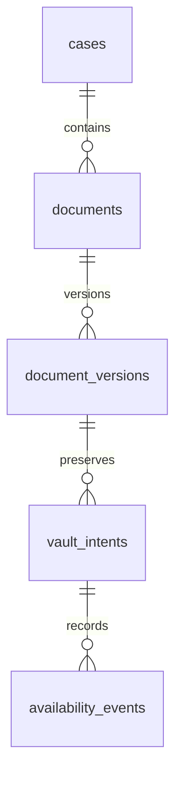

# VAULT-INT-001 — Real disposable Vault composition

## Outcome and scope

Connect the merged `VaultCoordinator`, `PrivateFilesystemByteStore` and
`DisposablePostgresVaultLedger` in one real PostgreSQL 17 integration command.
Base: `901c51d08dfac577d56799889701416e9139940d`. No production routes,
Supabase resources, schema migrations, role grants or customer data change.

## Existing relationships and transaction boundary



The diagram abbreviates existing `_s2_009b_*` fixture table names. Tenant/case
composite foreign keys and scoped metadata lookups are unchanged. Existing
audit/receipt constraints and indexes remain authoritative; no new index or
schema is needed. Each adapter call opens a real psycopg transaction. State,
case revision, audit, availability event and idempotency receipt commit together.
The immutable filesystem PUT remains outside that SQL transaction; reconcile
the frozen key after missing acknowledgments, without issuing another PUT.

## Access and safety model

The runner requires the existing explicit disposable flag, fixed local
`127.0.0.1:5432`, `caseproof_s2_ci`, ephemeral postgres owner and fixture password.
It rejects unsafe address overrides and explicitly pins libpq connection options.
New synthetic fixtures use actual source-byte hashes, separate organizations,
actors, cases and versions. No real user identity or runtime RLS is claimed.
Fresh subprocesses recreate all adapters/connections from synthetic manifests.

The inherited disposable ledger reads filter by scope, but do not authenticate
the supplied actor. The SQL writer rechecks membership. The revocation test
documents that coordinator byte dispatch can precede that writer check: genuine
pre-dispatch authorization and authorized reads remain production blockers.
Do not expose these fixtures or adapters through an API.

## Acceptance command and evidence

After the existing database fixture sequence:

```sh
uv run --locked python -m scripts.verify_vault_integration
```

Eight integration tests cover own-scope reads before foreign-scope negatives,
pending/private bytes and fresh-process recovery, stable retry/key preservation,
missing and same-length corrupt objects, actual audit-failure rollback,
lost acknowledgment after a real DB commit, concurrent adapter publication,
and revoked-writer denial. Independent connections inspect committed case,
audit, receipt and availability counts. Driver/database failures fail the job;
no skip or synthetic substitute is used for PostgreSQL.

The required database-security CI job runs this command after the existing
S2-009b SQL regression suite. psycopg binary is a locked development dependency
only. Existing locked unit, Ruff, mypy, architecture and SQL checks remain.
Record exact CI results on the PR; unexecuted checks are not completion evidence.

## Recovery and limits

CI deletes its service and temporary byte directories. No migration/rollback is
needed in a shared environment. Existing SQL invariants are unchanged. A green
run demonstrates disposable composition, not real Supabase Storage, trusted
signed identity, malware scanning, production durability or human approval.
Next: persist one versioned representation and resolve its exact source anchor
after restart, then integrate authenticated review and atomic decision/audit.
