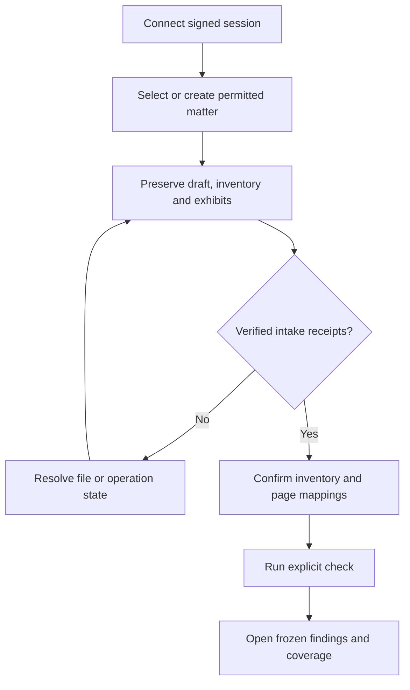
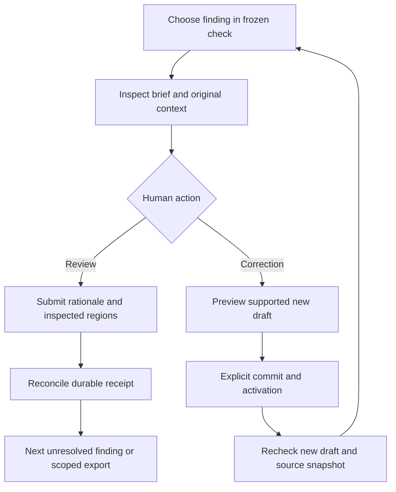

# CaseProof — authoritative frontend foundation and M3/M4 blueprint

**Version:** 1.0 · **Date:** 1 November 2026 · **Owner:** CaseProof engineering; independent acceptance owners not yet assigned.

**Status:** Owner-requested engineering direction. The foundation is implemented in PR #162; the remaining workspace capabilities below are acceptance requirements, not delivered features. This document grants no deployment, client-data, legal or milestone approval.

**Single entry point:** Read this file before designing, implementing or reviewing the real CaseProof frontend in `frontend`. It owns frontend structure, interaction, design and acceptance rules. `AGENTS.md`, `DESIGN.md`, `UX-CONTRACT.md` and `README.md` in this directory are pointers, not competing specifications. Legacy finance/ClearBrief screens are regression references, not the new client's architecture.

## 1. Authority, scope and change protocol

Repository [CONSTITUTION.md](../CONSTITUTION.md), [ADR 0011](../docs/adr/0011-architecture-freeze-and-first-finance-slice.md), [ADR 0022](../docs/adr/0022-verification-contract-report.md), [ADR 0025](../docs/adr/0025-deployment-data-retention-and-model-authority.md), and the [roadmap](../docs/ROADMAP.md) retain authority for security, evidence and product behavior. [ADR 0026](../docs/adr/0026-frontend-foundation.md) records the frontend decision. If this file conflicts with those contracts, resolve the conflict explicitly before implementing the affected behavior.

M3 is the authenticated web review workflow. M4 is safe reviewed output and reproducible reopening. First market: Belgian post-assembly DOCX brief, inventory, text PDF and scanned exhibits; NL/FR/EN. German, legal research, filing, a general DOCX editor, public MCP hosting and a Word-mandatory product are outside this increment.

Use **MUST**, **MUST NOT** and **SHOULD** as engineering requirements. A future capability remains OPEN until its evidence passes. An agent MUST NOT invent an owner, signer, permission, measurement, legal opinion or acceptance result.

Every material change records scope, accountable owner, affected contracts, implementation, test/artifact links, limitations and rollback. Update this file when a durable UI decision changes; update runtime code and tests in the same PR. Never rewrite the blueprint merely to legitimize implementation drift. Keep versioned historical evidence distinct from current-head results.

## 2. Outcome and non-negotiable invariants

The lawyer can create an authorized matter, intake and confirm preserved files, inspect each finding against source pixels and text, record a separate human decision, preview a supported correction, recheck, export and reopen the actual bytes after restart.

| ID    | Invariant                                                                                                                                                                                       |
| ----- | ----------------------------------------------------------------------------------------------------------------------------------------------------------------------------------------------- |
| UI-01 | Python application services own verification, authorization, workflow transitions, audit and export. React never recomputes or upgrades a verdict.                                              |
| UI-02 | Identity, page mapping, fidelity and human support remain independent. Coverage/processing completeness is shown separately. No overall GREEN/RED verdict or blanket verified badge.            |
| UI-03 | A quotation match is not semantic support, authenticity or human approval. Zero detected references is not complete verification.                                                               |
| UI-04 | Every sensitive read/write is server-authorized for the current actor, matter, source version and applicable snapshot. Host-injected credentials are not permission proof.                      |
| UI-05 | Missing, unsupported, ambiguous, partial and unassessed remain explicit. A crop pointer does not establish page mapping.                                                                        |
| UI-06 | Human decisions change only after a durable authorized backend receipt. Local hashes, flags and timestamps cannot create a review ledger or signature.                                          |
| UI-07 | Changed draft, inventory, source, representation or review revision cannot silently reuse stale confirmation or release.                                                                        |
| UI-08 | Originals remain immutable. Corrections create a new draft version; generated previews/exports are derivatives, never primary sources.                                                          |
| UI-09 | Confidential content, bearer tokens, rationale and source quotations are absent from analytics, logs, URLs and persistent browser storage by default. Opaque IDs/hashes may still be sensitive. |
| UI-10 | A local interface, CSP or synthetic browser test does not prove whole-system zero egress or professional-secrecy compliance.                                                                    |

## 3. Technology decisions and dependency ownership

| Layer          | Decision                                                             | Current implementation / adoption rule                                                                                                                                             |
| -------------- | -------------------------------------------------------------------- | ---------------------------------------------------------------------------------------------------------------------------------------------------------------------------------- |
| Build/runtime  | Vite static build; Node is build tooling                             | Vite 8.3.5 baseline. Production does not require a frontend Node server. Static host configuration is separately accepted.                                                         |
| UI             | React + strict TypeScript                                            | React 19.3.1 / TypeScript 6.0.3 baseline. TS 7 was incompatible with the selected lint toolchain. Use latest compatible stable versions, never force peer conflicts.               |
| Routing        | React Router                                                         | 8.5.1 baseline; do not downgrade to v7 because an old example says v7.                                                                                                             |
| Server state   | TanStack Query                                                       | v5. No persistence; retries explicitly disabled in foundation. Cache is not permission or verification authority.                                                                  |
| Styling        | Canonical CSS tokens and shared primitives                           | Current owner `src/app/theme.css`. Tailwind/shadcn may be added through a documented adoption change; neither is currently installed.                                              |
| API contract   | Python projection → JSON Schema → TypeScript + precompiled validator | Existing dossier endpoint stays canonical. Unknown consumed states fail closed.                                                                                                    |
| Findings table | Native semantics first; TanStack Table if needed                     | Not installed. Add for measured filtering/sorting/paging needs, not merely because a blueprint lists it.                                                                           |
| Viewer         | Replaceable evidence adapter                                         | No engine selected. Compare bounded server-rendered images with patched raw PDF.js. EmbedPDF/Lector require the same evidence if reconsidered. Never load two engines by accident. |
| DOCX           | Read-only, explicitly derived preview                                | No engine selected. `docx-preview` cannot promise Word-identical pagination.                                                                                                       |
| Diff/icons     | Add narrowly when a feature needs them                               | A read-only redline can use semantic `del`/`ins`. Evaluate any diff library's maintenance, compatibility and license.                                                              |
| Verification   | Vitest, Playwright, axe, ESLint, TypeScript and architecture checks  | Locked versions in `package-lock.json`; no test-only bypass in product code.                                                                                                       |

`package.json` and `package-lock.json` are authoritative for installed versions. Versions above identify the tested foundation, not an instruction to freeze patches forever. Dependency updates require compatibility, security and affected regression checks. Public source is not automatically reusable. Record license/notices, origin commit and modified files for any copied source. Preserve notices and review transitive engine/assets licenses. Do not copy incompatible GPL/AGPL or commercial code; do not claim that rewriting after studying a repository automatically resolves licensing obligations.

## 4. Structure and dependency direction

| Directory                   | Owns                                                                                   | May depend on                          |
| --------------------------- | -------------------------------------------------------------------------------------- | -------------------------------------- |
| `src/app`                   | Composition, routes, providers, session/query lifecycle, app error boundary, theme     | Feature public entry points and shared |
| `src/features/matters`      | Matter selection/create workflow when implemented                                      | Its own internals and shared           |
| `src/features/intake`       | Upload/confirm/recovery workflow when implemented                                      | Its own internals and shared           |
| `src/features/verification` | Findings, dimension display, filtering and snapshot reads                              | Its own internals and shared           |
| `src/features/evidence`     | Viewer adapter, source/crop inspection and coordinate display                          | Its own internals and shared           |
| `src/features/review`       | Human decision intent/rationale and receipt display when implemented                   | Its own internals and shared           |
| `src/features/corrections`  | Preview/apply/recheck interaction when implemented                                     | Its own internals and shared           |
| `src/features/exports`      | Export/reopen interaction when implemented                                             | Its own internals and shared           |
| `src/shared/api`            | Generated contracts, runtime validation, authenticated transport, error classification | Shared only                            |
| `src/shared/session`        | Memory-only credential source, session generation, cancellation/cleanup                | Shared only                            |
| `src/shared/ui`             | Reusable accessible primitives; no business-state inference                            | Shared only                            |
| `src/shared/lib`            | Small proven cross-feature utilities when needed                                       | Shared only                            |

Create a feature directory when implementing its first real behavior; no empty framework scaffolding. Within a feature, separate presentation, workflow coordination and API adapters as complexity requires. Do not add a repository/interface for every request. A viewer port is justified because its implementation is deliberately replaceable.

Features MUST NOT import app or another feature's internals. Cross-feature orchestration belongs in app. App imports features through `index.ts`; no wildcard exports. Shared MUST NOT import app/features. Network calls go through shared transport. AST negative-control tests enforce direction and detect common storage/evaluation/network shortcuts; static checks are not a sandbox against malicious code.

## 5. API contracts and state ownership

Python response validation/schema is the source for consumed wire fields; generated TypeScript MUST NOT be edited. Validate untrusted API responses at runtime as well as compile time. PR #162's `DossierView` is a **partial read-only projection**, not the complete M3 contract. Expand it against actual canonical fixtures before consuming additional fields.

Maintain separate per-dimension types. Do not introduce one universal state union that permits an identity state in the human-support field. Do not replace backend enum values with `IDENTITY_OK`, `PAGE_OK` or an overall color model. Unknown future enum values require an explicit compatibility path, not a success fallback.

Three page spaces are distinct: physical exhibit-PDF page, printed label and bundle-PDF page. Preserve each backend state, mapping basis and ambiguity. Null means unknown/unmapped unless the backend explicitly records not applicable. Roman printed labels are strings. Persisted exact coordinate/decimal-string contracts remain intact; numerical conversion is confined to display transforms and never changes canonical values or hashes.

| State                                                               | Owner / lifetime                                     |
| ------------------------------------------------------------------- | ---------------------------------------------------- |
| Findings, source identities, snapshots, permissions, saved reviews  | Backend authority                                    |
| Fetched report and processing state                                 | TanStack Query, memory only, scope/session-keyed     |
| Matter/brief/finding navigation and non-sensitive committed filters | Router; never quotes/rationale/tokens                |
| Unsaved rationale, active inspector mode, transient selection       | Feature-local state; explicit loss/recovery behavior |
| Credentials, cancellation, query and object-URL cleanup             | Central session boundary                             |

Every read checks exact case/brief/snapshot/source bindings before display. Requests have bounded time/size and cancellation. Reject redirects and unexpected content types. Do not display raw server error bodies. On session end or observed 401/403, abort reads, invalidate the generation, clear caches, revoke object URLs and remove private views. A late response cannot repopulate a cleared or changed session. Unobserved server revocation cannot erase information already read; do not imply continuous revocation detection unless implemented/tested.

Future writes MUST retain a stable operation/request ID for the exact submitted payload, prevent duplicate submit and classify definitive rejection versus unknown completion. Never automatically retry review, correction or release writes. An ambiguous outcome requires receipt lookup or retry of the same authorized operation through the backend contract; changed input cannot silently replace it. No optimistic confirmation ledger.

## 6. Deployment, hostile files and browser security

Use same-origin application API calls where possible. The development proxy targets the existing loopback `/v2` API; never invent a parallel `/api` contract or expose dev fixture/admin RPCs to the browser. Loopback serving is a mode choice, not proof that all processing is local. Hosted/hybrid/firm-controlled/offline modes require separate ADR 0025 evidence.

Serve production JS/CSS/workers/WASM/fonts from approved pinned assets. No CDN, analytics, session replay, remote fonts or document-bearing external URLs. No service worker, offline persistence or background synchronization without a separate retention/revocation design. Keep source downloads explicit and authorized; never treat a download as proof the human inspected it.

Production response headers MUST enforce CSP, `nosniff`, `no-referrer` and sensitive-response `no-store`. `security-headers.conf` records the intended baseline; the actual reverse proxy must be tested. Vite preview is not a production server. Prefer `default-src 'none'`, narrowly scoped `script-src`, `style-src`, `connect-src`, `img-src`, `font-src`, `worker-src`, `object-src 'none'`, `base-uri 'none'`, `form-action` and `frame-ancestors 'none'`. A meta policy is supplementary, not an equivalent replacement. Do not add `unsafe-inline`, `unsafe-eval`, blob workers or WASM permissions preemptively. Vite development/HMR permissions must be limited to development and never copied into production.

PDF/DOCX bytes are hostile input even after backend acceptance. Browser preview does not bypass bounded intake. PDF.js options must disable unnecessary scripting/evaluation and external resource behavior for the pinned version; terminate loading/render tasks and destroy documents/workers on switch/signout. Prevent untrusted links, attachments or active annotations from executing. Test hostile-file/resource limits and patch advisories. Workers isolate work but are not an automatic hostile-content security boundary.

Server-rendered images reduce browser PDF parsing exposure but retain renderer and image-decoding risks. Rendering must stay isolated, resource-bounded, hash/version-bound and server-authorized. Accessible extracted text must accompany pixels. No rendering path gets an exemption from source/representation provenance.

Do not display “0 bytes external egress”, “compliant with OVB/Avocats.be” or “secure because local”. A deployment badge may describe configured mode and link to a dated measured receipt with its scope/limits. Browser-request monitoring is one test, not whole-process/OS/network proof. Security/privacy/professional-secrecy acceptance remains independently owned.

## 7. Evidence viewer and coordinate acceptance

Default inspection pairs preserved pixels, separately labelled extracted text and provenance. A PDF canvas/text/overlay stack is an implementation candidate, not a mandated engine. Layer ordering and pointer behavior must preserve selection and keyboard access without letting overlays hide uncertainty or capture every interaction.

A coordinate record MUST identify original/representation hashes, physical page, coordinate space, origin, units, page bounds, rotation and relevant CropBox/MediaBox. Reject missing/inconsistent geometry; do not guess. Transform the box using the actual rendered viewport (including page origin, CropBox offset, units, rotation and scale), then project into the CSS overlay space. Percentage coordinates are valid **after** this transformation, not a substitute for it. Account for device-pixel-ratio canvas scaling separately from CSS geometry.

On document/reference change, cancel obsolete loading/render tasks and bind the pending target to exact source version, snapshot and selection generation. Wait for the correct page/render to become ready, revalidate the target, then focus/scroll. No stale render can replace the current document or scroll a newly selected finding. Smooth motion respects reduced-motion preferences. Keyboard users can reach the same target without hover or dragging.

| Fixture/workload                           | Required evidence                                                                                                                                |
| ------------------------------------------ | ------------------------------------------------------------------------------------------------------------------------------------------------ |
| Clean text PDF                             | Exact target box and matching source/version; native text remains selectable where offered                                                       |
| Image-only scan                            | Pixels visible; absent OCR remains unassessed; crop matches preserved image                                                                      |
| Rotated pages 90/180/270 degrees           | Expected target stays aligned after rotation, zoom and pane resize                                                                               |
| Non-zero CropBox origin / mixed page sizes | Explicit transforms align to the right content; no percentage-only shortcut                                                                      |
| Repeated quotations / multiple boxes       | No ambiguous selection promoted to a unique match                                                                                                |
| 200-page file                              | Bounded rendering/virtualization, measured load/navigation/memory, cancellation and cleanup; no claim that a UI test proves 200-page backend OCR |
| Hostile/oversized/corrupt input            | Bounded failure; no script/external resource execution; useful error without private-data logging                                                |
| Switch/signout/revocation race             | No wrong-source overlay, delayed page or retained private object URL                                                                             |

Compare server-image and patched raw-PDF.js candidates using the same fixtures and expected transforms. Record pinned engines/assets, browser, hardware/runner, pixel/CSS error tolerance, performance budget, actual measurements and reviewer. Define tolerances/budgets before measurement; do not invent passing numbers afterward. Viewer adoption requires the recorded comparison. Its absence keeps the engine unselected.

## 8. DOCX preview, anchors and corrections

A browser DOCX rendering is a derived representation, not Word layout or filing proof. `docx-preview` page-break options cannot establish true Word pagination. Unsupported fields, headers/footers, tables, text boxes, tracked changes, notes and missing regions must remain disclosed according to the backend coverage manifest. Sanitize/disable active/external/HTML-part content and impose input/DOM/image/font limits before any DOM-rendering adapter is accepted.

Citation anchors bind to backend draft version, part/region, declared offset encoding, range and reference ID. Backend bookmarks may assist only after validating their bindings. Literal-text search is a navigation convenience; repeated or split-run text cannot authorize a correction. Ambiguous or unsupported anchoring must stop and show why. Never mutate the preserved DOCX to make navigation work.

A correction preview shows original and replacement strings with semantic `del`/`ins`, scope and downstream effects. The backend validates the supported range and creates the derivative. Apply uses the existing preview/reserve/upload/fresh-readback/activate contract; refresh/recheck the new draft and keep prior originals/reports. Do not promise arbitrary Word comments or tracked changes beyond actual export support. Preview similarity alone is not an accepted corrected DOCX.

## 9. Findings, inspection modes and human review

Use a bounded queue/table with explicit dataset navigation. If adopting TanStack Table, retain semantic table/button controls; an ARIA grid requires its full keyboard model. Filters operate on server-supplied states and disclose scope/count denominators. Prefer “Needs review”, “Page unmapped”, “Source missing” and specific dimension labels over a global red/yellow/green classification. Four compact cells are acceptable when full text and explanations remain accessible. Coverage is never compressed away.

`NOT_IN_INVENTORY` requires confirmed-complete inventory. An inventory entry with no supplied source is `SOURCE_MISSING`. “Uncited inventory item” requires sufficiently complete draft discovery; otherwise label it as not detected in the assessed regions. Neither condition is silently assigned a legal consequence. English Exhibit references remain unsupported human-review items; PR #160's six notices are not successful matches.

Show PDF/printed/bundle page states together, including unknown, conflicting and not-applicable distinctions. Display draft quotation, original-language context, extracted text and image separately. “Scan / OCR layer / Quote diff” is a useful candidate, but OCR overlays must be labelled derived, preserve geometry/line wrapping and never obscure the original irretrievably. Provide a side-by-side alternative and plain text for assistive technology. Diff highlights character differences only; it does not decide legal or semantic support.

A human review requires current server-bound scope, source/snapshot inspection, an explicit disposition and rationale. UI reports “saved” only after the durable receipt. It cannot turn a deterministic conflict into agreement. Show actor/time/revision from the backend receipt, not browser assertions. Stale state is server-derived and considers all relevant versions; show persistent text/reason and required reinspection, never flashing badges. A hash is integrity evidence, not a qualified lawyer signature.

Shortcuts SHOULD include J/K or arrows for finding navigation, Space for inspection and E for correction preview when available. Single-character shortcuts need discoverability and a way to disable/remap or constrain them to the focused component. Ignore editable targets, IME composition and conflicting browser/assistive commands. C/X MUST NOT silently create a confirmation. They may open the relevant action; committing still follows explicit inspection/rationale/permission rules. Advance only after receipt, preserving the prior finding/history and recoverable failures.

## 10. UI ownership and accessibility contract

| Capability     | Canonical owner                                        | Source of truth                             | Allowed variants                                                     | Verification                                                       |
| -------------- | ------------------------------------------------------ | ------------------------------------------- | -------------------------------------------------------------------- | ------------------------------------------------------------------ |
| Form           | shared primitives + feature form                       | This blueprint and generated request schema | Open report / intake / review / correction as implemented            | Labels, inline errors, first invalid focus, duplicate-submit tests |
| Select/Listbox | shared/ui when introduced                              | Deliberately native or authored per feature | Native platform popup / accessible authored listbox                  | Keyboard, open popup, focus, locale and narrow viewport            |
| Scrollbar      | src/app/theme.css                                      | Section 11 runtime tokens                   | Geometry only                                                        | Visible global baseline, forced colors, narrow/reflow              |
| Toast          | shared/ui/Notice or accepted shared notification owner | Server outcome and this blueprint           | Inline status / alert; transient notification only where appropriate | Live-region and failure-state tests                                |
| CRUD           | Feature workflow + backend service                     | Canonical application contracts             | Only installed operations                                            | Authorized end-to-end receipt/reopen/retry tests                   |

Target WCAG 2.2 AA. Use native semantics, real labels, visible focus, sufficient contrast, logical headings/landmarks and skip navigation. Meaning never depends on color, hover, flashing, dragging or a keyboard shortcut alone. Every drag/resize action needs a keyboard alternative. Modal primitives need title/description, focus placement/trapping/restoration, Escape and reachable actions. Shared controls cover hover, focus, pending, disabled and error states.

Forms use noValidate with owned inline errors, aria-invalid/aria-describedby, preserved input and first-invalid focus. Avoid browser alert/confirm/prompt. Stable control geometry and meaningful busy state prevent accidental double actions. Loss of unsaved work uses a scoped accessible confirmation; no persistent recovery cache is introduced silently. Search is cancelable/stale-safe and IME-safe; clear is immediate and keyboard accessible. Non-empty search has a clear action.

Verify loading, empty, no-results, errors, slow requests, timeout, 401/403, stale 409, unknown completion, long localized text, narrow layout, 200% zoom/reflow, high contrast and reduced motion as applicable. NL/FR/EN copy, aria labels and date/number formatting must follow locale. Use Europe/Brussels for human event display with explicit timezone; preserve server timestamps. Automated axe checks do not establish manual screen-reader or practitioner acceptance.

## 11. Visual design and runtime tokens

The reviewer should feel they are inspecting a preserved dossier, not conversing with an AI or reading a finance dashboard. Document evidence dominates; selection and four independent dimension cells are the visual signature. No marketing hero, decorative score or repeated ornamental cards in the review workspace. Root finance design files do not govern this client's future workflow.

Canonical token owner: `src/app/theme.css`. Keep this table and runtime values synchronized when changing the design; do not create a parallel theme in copied components.

| Token/role              | Baseline value                                                     |
| ----------------------- | ------------------------------------------------------------------ |
| Accent / primary action | `--accent: #103a4b`                                                |
| Primary text            | `--ink: #172d38`                                                   |
| Secondary text          | `--muted: #435e6b`                                                 |
| Reading surface         | `--surface: #ffffff`                                               |
| Dividers                | `--line: #c7d4db`                                                  |
| Error                   | `--danger: #9a2727` plus text                                      |
| Focus                   | `--focus: #126a9b`                                                 |
| Canvas                  | `#f4f7f9`                                                          |
| Typography              | Local system sans; local monospace for hashes/technical provenance |
| Scale                   | 16px body; 12px metadata; 20–38px headings in the foundation       |
| Shape / targets         | 6px controls/cells; minimum 44px foundation controls               |

Header/content/footer; bounded finding queue beside a dominant inspection area. Foundation stacks below 760px. A later brief/source split uses accessible resizable panels and preserves reading space rather than squeezing three unusable columns. Natural document scroll remains available; each bounded panel owns its scrolling. Reserve image geometry and error/loading footprints; no layout jumps or hidden scrollbars. Global standards-based scrollbar styling includes engine fallback and forced-colors behavior. Avoid decorative motion; respect reduced motion. Shared primitives own consistent labels, spacing, intent and feedback.

Reference repositories supply ideas, not authority or automatic adoption: OpenContracts for evidence workflows, Extend UI for source-linked inspection, tablecn/data-table-filters for data navigation, and Mozilla's own API/examples for PDF transforms. Verify repository, license, branch, source paths and commit before use. `sec-insights` is archived; old AllenAI/Extend file paths in prior proposals are not executable instructions. Prefer a reviewed small permissive component over maintaining unnecessary custom infrastructure; never import a whole product backend or incompatible workflow.

### Design philosophy — evidence before decoration

Audience: a litigation lawyer reviewing a consequential reference under time pressure. The interface's job is to make inspection, uncertainty and the next authorized action understandable. The design is a professional reading workspace, not a chat-first assistant, marketing dashboard or simulated Word editor.

| Principle                 | Required design consequence                                                                                                                                            | Review question                                                                              |
| ------------------------- | ---------------------------------------------------------------------------------------------------------------------------------------------------------------------- | -------------------------------------------------------------------------------------------- |
| Evidence leads            | The selected reference and preserved source receive the strongest spatial hierarchy. Provenance and inspection controls remain near the source.                        | Can the reviewer locate the actual evidence without opening unrelated panels?                |
| Uncertainty stays visible | Missing mapping, partial coverage, OCR conflict and unassessed support use explicit words and reasons. Filtering never hides the scope denominator.                    | Could a busy reader mistake an unchecked result for a confirmed one?                         |
| Independent judgments     | Keep deterministic dimensions and human disposition visually distinct; never merge them into an overall score or green document seal.                                  | Is it obvious what the engine assessed and what a person decided?                            |
| Reading comfort           | Use restrained local typography, sufficient contrast, stable geometry and adjustable panes. Put visual emphasis on the selected evidence rather than ornamental cards. | Can the source and its context be read comfortably at normal and enlarged zoom?              |
| Progressive detail        | Show the reason, source and next action first. Put hashes, parser versions and detailed coverage in clearly labelled disclosure panels, preserving access to them.     | Does the initial view answer what needs attention without suppressing essential limitations? |
| Useful density            | Group related information and use compact rows where comparison benefits; retain readable text, focus visibility and operable targets.                                 | Does density save navigation without requiring tiny text or unexplained abbreviations?       |
| Predictable interactions  | One operation has one name, shared component and feedback pattern. Selection, navigation and saving are different actions.                                             | Would the same action behave differently elsewhere in the workspace?                         |
| Honest feedback           | Distinguish loading, pending, saved, rejected, stale and uncertain completion. Announce success only after the relevant server receipt.                                | Does the feedback describe observed state rather than a hopeful animation?                   |
| Accessible by default     | Keyboard, pointer and assistive-technology users can inspect the same evidence and invoke equivalent actions. No hover-only explanation or drag-only layout control.   | Is any essential information available only by color, hover or shortcut?                     |
| Restraint builds trust    | No flashing stale badges, decorative progress scores, approval confetti or gratuitous motion. Movement serves navigation and respects reduced motion.                  | Does this visual treatment help inspection or merely imply confidence?                       |
| Privacy is ordinary UX    | Do not expose source content in notifications, titles, browser history or telemetry. Describe the actual deployment mode without claiming unmeasured security.         | Could a screenshot, notification or logged URL disclose unnecessary matter content?          |

**Composition:** workspace context → finding queue/filter scope → selected finding and source inspection → separate human review/correction action → attributable history/export. This is information hierarchy, not a mandate to fit every region into three narrow columns. At small widths, preserve the task sequence and source context rather than shrinking the desktop layout.

**Reuse:** evaluate permitted source-linked review patterns and accessible primitives before inventing custom widgets. Adapt them to CaseProof's contracts and shared tokens. Do not copy another product's branding, business states or security assumptions. New shared patterns need documented purpose and interaction evidence; visual novelty alone is insufficient.

**Design review before acceptance:** exercise a clean reference, missing source, unmapped page, OCR conflict, incomplete coverage, stale snapshot and failed save. Inspect desktop/narrow layout, keyboard focus, long NL/FR/EN text, 200% zoom and applicable high-contrast/reduced-motion behavior. Automated checks enforce selected rules only; manual review and practitioner observation assess comprehension. Record findings and limits, not an unsupported “fully accessible” claim. Changes to this philosophy must update affected tokens/components and verification together; this subsection and Section 11 remain the sole design guidance.

## 12. Verification, CI and commands

From repository root:

```bash
uv run --locked python -m scripts.generate_frontend_contract --check
uv run --locked pytest -q tests/test_frontend_contract.py
uv run --locked ruff check application/litigation/frontend_contract.py scripts/generate_frontend_contract.py tests/test_frontend_contract.py
uv run --locked mypy --explicit-package-bases application/litigation/frontend_contract.py scripts/generate_frontend_contract.py
```

From `frontend`:

```bash
npm ci
npm run contracts:check
npm run lint
npm test
npm run build
npx playwright install --with-deps chromium
npm run test:e2e
```

When deliberately changing contracts: run `uv run --locked python -m scripts.generate_frontend_contract` at root, then `npm run contracts:generate` here. Commit both generated outputs and changes to compatibility tests. CI must reject drift, unknown states and architecture sabotage. Review network/storage shortcuts and security-sensitive changes; static checks alone are insufficient.

The frontend workflow tests the built static application under production CSP. Keep synthetic transport fixtures explicit and isolated to tests; no in-product fake session/data fallback. Browser request assertions cover browser traffic only. Never use user documents or real credentials in public artifacts. Retain synthetic screenshots/traces for the configured limited duration, with access/retention reviewed for any future private evidence.

| Required evidence            | Negative/control cases                                                                                                |
| ---------------------------- | --------------------------------------------------------------------------------------------------------------------- |
| Dependency boundaries        | shared→feature, feature→app, feature-internal imports, unapproved persistence/network shortcuts must fail             |
| Contract compatibility       | Actual backend fixtures, unknown states, duplicate IDs, malformed or oversized payloads, wrong matter/brief/snapshot  |
| Session lifecycle            | Signout/access denial, old token resolution, late response, cancellation, route switch and resource cleanup           |
| UI behavior                  | Empty/partial report, escaped hostile strings, bounded paging, labels, error focus, keyboard selection, narrow layout |
| Review/write path when built | Revocation, stale revision, audit rollback, duplicate/unknown outcome, reload and cold reopen                         |
| Viewer when built            | Section 7 hard-case matrix, annotated expected transforms and measured performance                                    |
| M4 when built                | Actual exported bytes reopened; hashes, corrected scope, source links, stale/foreign/revoked denial                   |

**Recorded foundation baseline:** code `d41ccca768d492f95917d170bc7639ab88d2c755` in [PR #162](https://github.com/haytamAroui/caseproof/pull/162): [frontend CI](https://github.com/haytamAroui/caseproof/actions/runs/41294319977) passed 15 unit/architecture tests, two Python projection tests and five Chromium browser tests; [kernel/integration CI](https://github.com/haytamAroui/caseproof/actions/runs/41294319980) passed 1,902 Python tests with four live gates intentionally skipped. All 16 automatic runs passed. This is dated foundation evidence, not a substitute for checks on later commits. No manual screen-reader, real signed React-browser, viewer or full M3/M4 acceptance follows from it.

### Local operation and host integration

Use Node 24 and the locked dependency tree. From `frontend`, run `npm ci` then `npm run dev`. The development URL is `http://127.0.0.1:5173/workspace/`; Vite binds loopback and proxies `/v2` to `http://127.0.0.1:8000`. The existing backend must be started through its authorized injected development composition. Do not expose its fixture/admin interfaces. This foundation does not start the backend or create users/matters automatically.

The current credential-source shape is the existing host bridge:

```ts
interface SessionHost {
  getBearer(): Promise<string>;
  clear?(): void;
}
// Current composition reads window.caseproofSession from a trusted host.
// It is not accepted from a document, URL, localStorage or model output.
```

Clicking Connect session only attaches that credential source; the API still decides every permission. Without a configured host, the client displays an actionable unavailable state, not a sample login or fake dossier. Actual host/authentication-provider installation is F1. Developers MUST NOT paste tokens into committed code, product inputs, URLs or logs.

An existing report can be opened at `/workspace/matters/:caseId/briefs/:briefId?snapshot=:snapshotHash`; the exact frozen snapshot must already exist and be authorized. `finding` and bounded `page` navigation are optional URL state. The foundation form takes these opaque report identifiers only; manual IDs are a foundation limitation, not the eventual intake experience.

For an authorized build inspection, run `npm run build` then `npm run preview -- --port 4173`; open `http://127.0.0.1:4173/workspace/`. Preview enforces its configured response headers but is not a production hosting approval. A real deployment serves `dist` at `/workspace/`, gives that route an SPA fallback, keeps `/v2` on the existing API without an SPA fallback, and independently verifies headers, session routing, asset egress, revocation and rollback. No frontend environment variable may contain a service key or backend secret.

## 13. Build sequence and exit gates

| Slice                      | Deliverable                                                                                                      | Exit evidence                                                                                                 | Current state                                       |
| -------------------------- | ---------------------------------------------------------------------------------------------------------------- | ------------------------------------------------------------------------------------------------------------- | --------------------------------------------------- |
| F0 Foundation              | Structured client, generated projection, transport/session lifecycle, shared primitives, read-only frozen report | Architecture negatives; contract checks; unit/build/browser/axe; clear scope and rollback                     | Merged in PR #162 (main dcad45a); F1–F6 remain open |
| F1 Signed host integration | Reviewed authentication/session adapter and authorized matter/report navigation                                  | Genuine signed browser grant/foreign/revoked/expiry tests; no token persistence                               | OPEN                                                |
| F2 Viewer decision         | Same-fixture server-image/PDF.js comparison through the evidence port                                            | Section 7 matrix and accepted engine/asset/security record                                                    | OPEN                                                |
| F3 Intake                  | User-created matter, full DOCX/inventory/text-PDF/scan upload, confirm and recovery                              | Browser journey without manually seeded identifiers; fresh original hash readback; interrupted/denied cleanup | OPEN                                                |
| F4 Review workspace        | Source/brief navigation, page-space display, uncertainty/coverage, human rationale and durable receipt           | Genuine browser review, stale/revoked/unknown-outcome/restart tests; accessibility and language checks        | OPEN                                                |
| F5 Correction/recheck      | Supported redline preview, new draft activation and canonical recheck                                            | Original unchanged; stale/competing/retry rejection; actual new draft/report reopened                         | OPEN                                                |
| F6 M4 delivery             | Scoped report and supported corrected/annotated DOCX; actual source navigation                                   | Download/reopen/link/hash/permission tests on actual bytes; limitations disclosed                             | OPEN                                                |

Do not block the evidence spike on a complete shell, or replace working backend services to suit a UI library. Practitioner interviews and representative review proceed independently of this engineering sequence. No practitioner findings are fabricated by tests.

M3/M4 are accepted only through their roadmap/acceptance contracts and named owners. Independent M0 gold, representative M2 accuracy, deployment/retention/security/professional-secrecy gates remain separately open. A foundation PR merge does not close them.

## 14. Delivery and rollback rules

Every frontend PR states: concrete user outcome, changed paths/contracts, tested commit, exact cloud results/artifacts, security/permission impact, untested claims, open gates and next bounded slice. Do not present a draft or mocked interaction as deployed behavior. Do not merge or deploy autonomously without user authorization and applicable review controls.

The foundation is unmounted. Rollback removes/disables its static build/workflow without changing backend storage or existing clients. Later production mounting needs an explicit route/proxy/header/session plan and rollback test. Retire a temporary client only after equivalent real-client workflows pass; do not keep it as a second authoritative verification engine.

## 15. Primary references

- [CaseProof frontend ADR](../docs/adr/0026-frontend-foundation.md), [canonical report contract](../docs/adr/0022-verification-contract-report.md), [deployment evidence](../docs/security/DEPLOYMENT_EVIDENCE_RUNBOOK.md).
- [React application setup and tradeoffs](https://react.dev/learn/build-a-react-app-from-scratch), [Vite backend integration](https://vite.dev/guide/backend-integration), [React Router modes](https://reactrouter.com/start/modes), [TanStack Query](https://tanstack.com/query/latest/docs/framework/react/overview).
- [PDF.js API](https://mozilla.github.io/pdf.js/api/draft/module-pdfjsLib.html), [Mozilla PDF.js security advisories](https://github.com/mozilla/pdf.js/security/advisories).
- [docx-preview limitations and break behavior](https://github.com/VolodymyrBaydalka/docxjs/blob/master/README.md).
- [CSP reference](https://developer.mozilla.org/en-US/docs/Web/HTTP/Reference/Headers/Content-Security-Policy), [frame-ancestors header limitation](https://developer.mozilla.org/en-US/docs/Web/HTTP/Reference/Headers/Content-Security-Policy/frame-ancestors).
- [WCAG 2.2](https://www.w3.org/TR/WCAG22/).
- [OVB/OBFG AI guidance](https://www.ordevanvlaamsebalies.be/nl/kennisbank/digitalisering/richtlijnen-voor-advocaten-rond-gebruik-van-artificiele-intelligentie): relevant safeguards, not certification of this product.

## 16. M3 engineering rules and CI enforcement

Product philosophy: inspect evidence, preserve uncertainty, and require an attributable human decision. The interface is a delivery adapter, never an independent verifier, access-control authority or database client. Develop one observable lawyer outcome per slice.

Database philosophy: browser code MUST NOT issue SQL, call database/storage/admin SDKs, create Auth identities, grant roles, bypass the API, own migrations or write a parallel ledger. The backend owns tenant predicates, transactions, idempotency, audit, persistence and retention. A schema change needs separately reviewed backend migrations and disposable isolation/recovery tests; a UI task grants no migration permission. No database connection string or service credential may enter a frontend build. An eventual auth-specific SDK adapter requires an explicit narrowly scoped policy change, not an exemption allowing direct data access.

`scripts/m3-policy.json` is the machine-readable design-token/command projection of this blueprint. `npm run policy:check` rejects token/document drift, competing UI guidance, missing scripts, prohibited database packages, external CSS assets and weakened response-header policy. Update blueprint, projection, runtime tokens and tests together for approved changes. The projection is executable enforcement, not a second prose specification.

AST checks additionally reject common direct database imports, raw HTML injection, screen-local inline styles and computed global-access shortcuts. Negative tests prove rejection. These checks are development guardrails, not a security sandbox or complete malicious-code detector. Security still needs server enforcement, review and runtime acceptance.

CI gates: generated-contract drift and Python projection compatibility; strict TypeScript; ESLint/hooks; architecture negative controls; M3 design/database/security policy; unit tests; production static build; Playwright keyboard, accessibility, session, paging and failure tests; existing backend architecture/disposable integration workflows. No skip/disable/expected-output weakening to obtain green CI. New functionality adds relevant adversarial tests. Manual assistive-technology, genuine signed-browser and deployment/representative-data acceptance remain separate.

Commands: from `frontend`, run `npm run policy:check` alongside Section 12 commands. Backend contract changes regenerate both schema and types. Runtime business changes cannot be justified by manually updating mock fixtures alone.

## 17. Page inventory and backend-to-screen coverage

**Planning status, 1 November 2026:** the following is the required M3/M4 experience, not an implemented route inventory. Only the frozen-report route in Section 12 exists in the React foundation. All additional browser paths below are proposals; preserve existing deep links during implementation. This section extends the single UI specification and does not supersede the product acceptance workflow in [PRODUCT_WORKFLOW](../docs/PRODUCT_WORKFLOW.md).

The navigation has three levels: permitted matters, the selected matter, and its selected draft/report snapshot. Matter navigation exposes Overview, Sources, Inventory, Checks, History and Exports. A finding opens inside the Checks workspace with brief, evidence and review panels; OCR modes, correction previews and crop inspection are panels/dialogs, not separate top-level products. Do not implement a generic administration dashboard, legal research, document assembly, court filing or finance screens for launch.

### Required pages and surfaces

| ID / proposed browser location                                                         | Purpose and primary actions                                                    | Required content and exit condition                                                                                                                                                                                                 | Slice                                  |
| -------------------------------------------------------------------------------------- | ------------------------------------------------------------------------------ | ----------------------------------------------------------------------------------------------------------------------------------------------------------------------------------------------------------------------------------- | -------------------------------------- |
| P01 / `/session`                                                                       | Connect through the reviewed trusted session host; disconnect                  | Connection/expiry/denial states; approved processing-mode disclosure; no password/token form invented by the UI. Return only to a validated internal destination after fresh authorization                                          | F1                                     |
| P02 / `/workspace/matters`                                                             | List permitted matters; open or start creation                                 | Loading, empty authorized list, unavailable list and denied access remain distinct. Show only server-returned summaries; opaque IDs alone grant nothing                                                                             | F1                                     |
| P03 / `/workspace/matters/new`                                                         | Create a private matter in a permitted organization                            | Required title and server-authorized organization choice, validation, stable operation identity, creation receipt. No free-text tenant ID, grants or invented role picker                                                           | F3                                     |
| P04 / `/workspace/matters/:caseId`                                                     | Resume the next valid task                                                     | Active draft/version, inventory confirmation, source/processing coverage, latest frozen check and unresolved work. Display independent readiness facts; no overall verified score                                                   | F3–F4                                  |
| P05 / `/workspace/matters/:caseId/sources`                                             | Add DOCX, inventory, exhibit PDFs/scans and optional bundle; monitor/reconcile | Per-file role, immutable version/hash, declared limits, transfer/readback/ingest stages, job state, unsupported regions, cancel/recovery. Completion requires backend receipt, not progress reaching 100%                           | F3                                     |
| P06 / `/workspace/matters/:caseId/inventory`                                           | Review candidate entries, aliases, source bindings and page spaces             | Inventory completeness declaration, missing/ambiguous sources, printed/piece/bundle mappings and revision. Confirmation requires current server permission and acknowledged revision; conflicts remain unresolved                   | F3                                     |
| P07 / `/workspace/matters/:caseId/briefs/:briefId` with required snapshot when reading | Start an explicit check or reopen a frozen report; select and inspect findings | Existing route compatibility; four independent dimensions, coverage denominator, unsupported references, page spaces, original/crop context, rationale and receipt. A missing snapshot must not cause a passive read to run a check | F4                                     |
| P08 / `/workspace/matters/:caseId/history`                                             | Reopen immutable checks, source/draft revisions and review receipts            | Authorized history only; distinguish historical snapshot from current source universe and stale decisions. Do not imply the backend already exposes a complete history-list API                                                     | F4–F5                                  |
| P09 / `/workspace/matters/:caseId/exports`                                             | Choose a frozen snapshot and supported artifact; download and reopen           | Exact included scope, exclusions, review state, source versions and output digest. JSON/Markdown/annotated DOCX only where supported; no invented PDF/signed-certificate export                                                     | F6                                     |
| P10 / `/workspace/matters/:caseId/data`                                                | Explain processing, retention and available deletion/request mechanisms        | Approved mode-specific policy, access and backup rules; unknown policy blocks confidential-use claims. Destructive controls stay unavailable until separately authorized API and permission contracts exist                         | Disclosure F1; controls separate scope |

Shared unavailable/not-found, expired-session, stale-snapshot and unexpected-error surfaces belong to these routes rather than separate fake matter pages. Preserve non-sensitive return navigation after session expiry, but clear document bytes and private state. Never reveal whether a forbidden matter or source exists.

Workspace sub-surfaces: W01 finding queue/filter/search; W02 anchored brief preview; W03 original page/crop inspector and three page spaces; W04 coverage and inventory exceptions drawer; W05 human review form/receipt; W06 correction preview/commit dialog; W07 check/recheck progress and frozen-run comparison; W08 optional separately labelled model-note panel. W08 is not required to finish the deterministic workflow and cannot write findings or human decisions.

### Inspected backend capability map

**Evidence scope:** these paths identify existing source implementations, not installed production services. The development composition is loopback-only and dependency-injected. Each new browser integration must confirm its mounted runtime, generated request/response/error contract and least-privilege authorization before use. Do not copy temporary `/dev` URLs into a public production contract.

In this table, `D` means `/v2/matters/{case_id}/briefs/{brief_id}/dossier`; `J` means `/v2/matters/{case_id}/page-jobs`.

| Backend responsibility / inspected evidence                                                                                                                                      | Existing interface                                                                                                   | UI consumer and integration gap                                                                                                                                        |
| -------------------------------------------------------------------------------------------------------------------------------------------------------------------------------- | -------------------------------------------------------------------------------------------------------------------- | ---------------------------------------------------------------------------------------------------------------------------------------------------------------------- |
| Signed session and permitted matter catalog — [development composition](../apps/api/litigation_development_app.py), [catalog](../apps/api/signed_supabase_matter_catalog.py)     | Development config/catalog; host session bridge in Section 12                                                        | P01/P02. New React host/provider and approved catalog contract still needed; no browser database access                                                                |
| User-created matter and preserved source intake — [live journey router](../apps/api/litigation_live_journey.py)                                                                  | Development POST matter, source reservation, upload, ingest and brief creation; GET manifest/state under `/dev/live` | P03/P05. Adapt existing services through reviewed runtime endpoints; real browser validation, stable recovery and multi-file preflight are required                    |
| Confirmation — [dossier router](../apps/api/dossier_journey.py)                                                                                                                  | POST `D/confirmation`                                                                                                | P06. Generate the full contract, show exactly what is being confirmed and reconcile the returned inventory revision                                                    |
| Processing recovery — [page jobs](../apps/api/signed_page_jobs.py)                                                                                                               | POST `J`, GET `J/{request_id}`, POST cancel, GET authorized page artifact                                            | P05/W07. Wire only in an approved composition; preserve pending/partial/failed/cancelled/unknown and current grants                                                    |
| Deterministic check and frozen reopen — [dossier router](../apps/api/dossier_journey.py)                                                                                         | POST `D/checks`; GET `D?snapshot_hash=…`; POST `D/recheck`                                                           | P07/W07. Current React projection covers only part of the read report. Expand generated contracts before building omitted coverage/actions                             |
| Original/crop/page context — [dossier router](../apps/api/dossier_journey.py)                                                                                                    | GET source original, GET source page (PDF), GET frozen region crop (PNG); POST frozen crop batch                     | W02/W03. Full-page PNG is not established by these endpoints. Complete Section 7 viewer spike; do not invent a page-image route or treat crop as verified page mapping |
| Lexical source search — [search app](../apps/api/litigation_search_app.py)                                                                                                       | POST `/v2/matters/{case_id}/briefs/{brief_version_id}/evidence/search`                                               | W01/W03. Optional scoped retrieval, not a verdict; query cancellation, explicit result scope and source-open authorization required                                    |
| Durable human review — [dossier router](../apps/api/dossier_journey.py), [review workspace](../apps/api/litigation_review_workspace.py)                                          | POST `D/reviews`, frozen snapshot/current finding and inspected-region checks                                        | W05. Server receipt controls saved state; typed rationale, actor and all required region inspections. Do not substitute legacy review APIs as a second authority       |
| Correction and new draft — [draft revisions](../apps/api/dossier_draft_revisions.py), [dossier router](../apps/api/dossier_journey.py)                                           | POST `D/corrections/preview`, POST `D/corrections/commit`, then POST `D/recheck`                                     | W06/W07. Explicit supported scope, stable operation, new version activation and fresh report; no browser DOCX mutation                                                 |
| History and stale lineage — [report contracts](../application/litigation/dossier_contracts.py), frozen dossier reopen                                                            | Known-snapshot reopening and persisted review data; development matter state                                         | P08. A complete authorized list/pagination/history comparison contract is still to be established. Do not infer history from a browser cache                           |
| Scoped export — [dossier router](../apps/api/dossier_journey.py)                                                                                                                 | GET `D/export` with frozen snapshot and JSON/Markdown/DOCX format; output digest                                     | P09. Download actual bytes, verify response binding/digest and independently reopen. Corrected draft and annotated appendix are distinct artifacts                     |
| Optional model notes — [model notes](../application/litigation/model_notes.py)                                                                                                   | Application capability; no new public route assumed here                                                             | W08 only after explicit matter policy and authorized transport; separate note/review request, never deterministic or reviewer-state mutation                           |
| Retention/deletion and access lifecycle — [ADR 0025](../docs/adr/0025-deployment-data-retention-and-model-authority.md), [retention checks](../scripts/retention_live_checks.py) | Backend policy/migrations and operator tooling; no approved general browser administration contract assumed          | P10 disclosure; separate operator scope for holds, purge, grants and backups. Never expose privileged scripts or fabricate controls                                    |

Every feature implementation must add a traceable row linking screen ID, exact mounted API, generated schema, permission requirement, mutation/reconciliation behavior and acceptance test. These inspected Python modules are the current evidence, while API contracts remain backend-owned. A missing interface is an explicit integration task, not permission to move logic into React.

## 18. End-to-end user flows and transition rules

### First matter and check



UF01: P01 → P02 → P03/P04 → P05 → P06 → P07. The overview may offer independent existing tasks, but may not silently confirm inventory, infer page offsets or run checks. Existing matters reopen by an authorized server snapshot. Intake preflights all originals before writes where the backend requires all-or-nothing validation; a corrupt final file must not cause earlier files to be written. Partial processing is shown separately from successful preservation. Missing OCR remains partial, not successful text verification.

### Inspection, decision, correction and recheck



UF02: P07/W01 selection synchronizes W02 and W03 only after the correct document/page has loaded. Repeated quote occurrences bind by backend location, not first textual match. Source unavailable, unmapped page, missing crop or unsupported DOCX region remains visible. Keyboard actions respect focused inputs/dialogs and never certify inspection merely because a download started. Unsupported English “Exhibit” references stay human-review notices, including the six synthetic misses documented in PR #160.

UF03: W05 saves only after an explicit human action and current permission. Keep deterministic dimensions unchanged. Distinguish draft form, saving, outcome unknown, durable acknowledgement and stale receipt; advance only after a valid acknowledgement. Rationale/decision is attributable to the server-authenticated actor, not a name typed into a ledger.

UF04: W06 preview displays exact supported old/new span, exclusions and proposed output; commit is separate. The original remains immutable. A source/draft change between preview and commit blocks activation and requires renewed context. After acknowledgement, open the new draft/version and explicitly recheck; old decisions remain historical and affected confirmations stale. A correction proposal is not a completed correction.

UF05: P09 chooses an immutable snapshot, displays coverage/limitations and included human decisions, then downloads the requested supported artifact. Verify actual artifact identity and reopen it outside the current in-memory screen. Cold restart → P01/P02/P08 → the same authorized frozen report and receipts must work without cached material. A historical export does not assert current-source validity.

### Failure, recovery and permission behavior

| Trigger                                                                  | Required user-visible behavior                                                                                           | Permitted next step / acceptance                                                                                 |
| ------------------------------------------------------------------------ | ------------------------------------------------------------------------------------------------------------------------ | ---------------------------------------------------------------------------------------------------------------- |
| Empty authorized list, no files or zero detected references              | Different empty messages with coverage and next valid action; never “everything verified”                                | Create/add where permitted; zero-reference report retains scan exclusions                                        |
| Validation, password-protected/corrupt/unsafe file or unsupported region | File/scope-specific rejection with actionable reason and preserved processing denominator                                | Replace through a new source version or leave explicit unresolved scope; no silent omission                      |
| Timeout/disconnect after upload, review or correction write              | “Outcome unknown”; preserve stable operation identity in the approved lifecycle, lock duplicate consequential submission | Authorized read/reconciliation and fresh hash-verified readback; never treat HTTP 409 or network loss as success |
| Retry/restart                                                            | Show server-reconciled operation/job and immutable input identity                                                        | Retry only supported idempotent operation with the same identity; no automatic review/correction mutation retry  |
| Stale snapshot, competing review or changed source/draft                 | Keep old result labelled historical/stale; block inappropriate save                                                      | Refresh authorized current context, inspect changes and reconfirm/recheck explicitly                             |
| Session expiry/revocation/foreign matter                                 | Stop reads/polling/workers, abort requests, clear sensitive caches/URLs/DOM and unsaved private state                    | Reconnect and freshly authorize. Late responses cannot repopulate an old session                                 |
| Service/worker unavailable or partial OCR                                | Separate transport/processing fault from verification states; known processed/remaining counts                           | Resume supported job or review available scope with explicit limitations                                         |
| Export rejected or interrupted                                           | No completed/exported badge; preserve original and report                                                                | Retry a scoped read when authorized; verify bytes and digest before reporting completion                         |
| Leaving dirty review/correction form                                     | Accessible leave/discard choice; no background save                                                                      | Stay or explicitly discard. Session loss still clears sensitive drafts                                           |
| Unavailable catalog/history/retention integration                        | State that this capability is unavailable; do not use fake entries or admin fallback                                     | Implement and approve the missing backend contract before enabling the action                                    |

Authorization remains server-owned per request. Do not invent “lawyer/admin/viewer” permissions from labels: read, source access, create/upload, confirm, review, correct, export and retention actions each need the actual backend capability contract. Hide or disable unavailable actions with an accessible reason when safe; a hidden control is not enforcement. Route entry, artifact download, job polling and final submission reauthorize independently.

URL state contains only approved opaque identifiers and bounded navigation/filter parameters; no bearer, citation text, document title or private quote. Form drafts stay ephemeral unless a separately reviewed persistence contract exists. Downloads already delivered outside the app cannot be recalled by cache clearing; communicate this accurately in retention/access disclosure.

## 19. Screen acceptance and implementation order

**Ownership:** frontend engineering owns P/W surfaces and accessibility; backend engineering owns APIs, permissions, transactions and durable recovery; security/privacy reviewers own deployment/egress/retention acceptance; practitioners/product owner own usability and representative legal-workflow acceptance. Named individual assignments and approvals are pending, not inferred from this document.

| Flow / surfaces    | Required executable evidence before acceptance                                                                                                                                                                                                                             |
| ------------------ | -------------------------------------------------------------------------------------------------------------------------------------------------------------------------------------------------------------------------------------------------------------------------- |
| UF01 / P01–P06     | Genuine signed authorized user creates matter and uploads actual synthetic DOCX, inventory, text PDF and scan without seeded IDs; same-org ungranted and cross-org denial; corrupted final file, duplicate labels, revocation, interrupted upload/readback and cold resume |
| UF02 / P07 W01–W04 | Clean/scanned/rotated/cropped/long-file viewer matrix; keyboard selection and correct occurrence binding; separate page spaces/dimensions; partial OCR, translation and unsupported detection coverage; late-document response fencing                                     |
| UF03 / W05         | Actual API receipt survives fresh browser and server restart; every required region inspection and rationale; stale/unknown/denied/competing-save cases; no optimistic supported verdict                                                                                   |
| UF04 / W06–W07     | Exact preview→explicit commit→new preserved draft→recheck→fresh reopen; original hash unchanged; unsupported spans block; lost acknowledgement and version conflict reconcile without duplicate activation                                                                 |
| UF05 / P08–P09     | History scoped to current grant; actual JSON/Markdown/DOCX bytes and digest; independently reopen output and source links; distinguish corrected draft from annotated report; revocation denies new export                                                                 |
| Shared / P01–P10   | WCAG 2.2 AA automated checks plus manual keyboard/screen-reader/zoom/reduced-motion review; NL/FR and EN UI checks; CSP and approved-origin request capture; no private telemetry; session clearing/late-response denial                                                   |
| P10 / optional W08 | Accurate per-mode policy and retention/backup disclosure; no unapproved destructive action; optional note cannot mutate any deterministic or human decision                                                                                                                |

Implementation order follows F1–F6 in Section 13: signed host and permitted navigation → viewer spike → real intake/confirmation → full review → correction/recheck → export/reopen. Build the smallest complete flow, not every shell page first. P04 is assembled from real capabilities as they land; P08/P09 get listing/transport contracts before decorative placeholders. P10 disclosure appears when the processing mode is shown; administration and optional model notes do not block the core deterministic journey.

Before each screen implementation, record its inputs, server contract, authority, loading/empty/error/stale states, primary action, keyboard/focus behavior, responsive arrangement and exit evidence in its PR against these IDs. Update this file if behavior changes; do not create another competing UI roadmap. Passing foundation CI does not accept these future flows or close M0/M2/security/practitioner gates.

## 20. M3 implementation increment — permitted matter navigation

P02 now consumes `GET /v2/workspace/matters`, mounted **only** in the injected
loopback development composition. It wraps the existing `SignedMatterCatalog`:
unchanged signed bearer → existing PostgREST invoker view/RLS → bounded projection.
No new database query, migration, role, grant, auth provider or production mount.
The generated `MatterCatalogView` schema permits at most 100 unique non-nil matter
IDs with positive revisions and descriptive states. State text grants no action.
Overflow fails closed; pagination beyond the bounded catalog is not implemented.

P02 uses 20-row URL paging, explicit refresh and loading/empty/error states. A failed
refresh hides prior results. Session end/access denial uses the existing request
abort, generation fence and cache cleanup. Matter selection opens the existing
report form with its matter field fixed; `/reports/open` retains manual report
opening. Brief/snapshot history, creation and intake remain unavailable. A manually
entered matter route is no permission proof; every report read reauthorizes.

| Surface | Mounted API / schema                                                                                                          | Permission and reconciliation                                                                          | Evidence                                                                                                                                              |
| ------- | ----------------------------------------------------------------------------------------------------------------------------- | ------------------------------------------------------------------------------------------------------ | ----------------------------------------------------------------------------------------------------------------------------------------------------- |
| P02     | `/v2/workspace/matters`; `application/litigation/workspace_contract.py` → `matters.schema.json` → precompiled validator/types | Existing signed invoker-view visibility; read-only explicit refresh, no optimistic records or mutation | `tests/test_workspace_catalog.py`, existing signed catalog adapter tests, `frontend/tests/matters.spec.ts`, `frontend/src/shared/api/matters.test.ts` |

This is an F1 navigation increment, not F1 acceptance. The existing trusted-host
bridge remains required; genuine signed React-browser grant/foreign/revoked/expiry
acceptance, provider installation, NL/FR localization and manual accessibility
review remain open. Browser transport fixtures are synthetic and do not prove RLS.
Rollback removes this router include and matter feature/routes; existing catalog,
reports, preserved sources and legacy clients are unchanged.

## 21. F1 signed-workspace implementation candidate

[ADR 0027](../docs/adr/0027-workspace-signed-session-and-report-navigation.md)
records the existing-provider same-origin password adapter, memory-only access
session, explicit expiry/relogin, protected genuine browser acceptance and read-only
report navigation proposal. No refresh-token persistence, client database SDK,
public listener or new provider. P01 owns sign-in with shared primitives; P02
retains the existing matter list; selecting a matter now opens its bounded frozen
report catalog and an existing report link. Manual `/reports/open` remains an
advanced compatibility path. Hash-order paging is explicit and not chronological.

| Surface               | Exact interface / schema                                                                                                      | Authority / acceptance                                                                                                 |
| --------------------- | ----------------------------------------------------------------------------------------------------------------------------- | ---------------------------------------------------------------------------------------------------------------------- |
| P01                   | POST `/v2/workspace/session`; `SessionView` → generated schema/types/precompiled validation; POST `/v2/workspace/session/end` | Existing pinned Auth password transport + remote user verification; no new permission or refresh-token exposure        |
| P02 report navigation | GET `/v2/workspace/matters/{case_id}/reports?after=…`; `ReportCatalogView` → generated schema/types/precompiled validation    | New read-only SQL proposal over existing grants; actual installation and genuine denied/revoked browser proof required |
| Runtime               | Explicit trusted built-static directory in loopback composition                                                               | Fixed asset allowlist, no SPA fallback for APIs, same-origin CSP; no automatic production mount                        |

401/403/404 sensitive reads end the local session, cancel requests and clear query
cache/private routes, including masked denied resources. This deliberate fail-closed
variant can require re-sign-in after an invalid report link. 409 remains a stale
snapshot error, never a successful write. Session expiry clears idle DOM as well as
requests; every read rechecks expiry even if browser timers were suspended. Provider
sign-out errors are disclosed without restoring local data. Downloaded files and
unexpired issued JWTs cannot be recalled by browser clearing.

F1 remains a candidate until the exact commit's synthetic/disposable and protected
genuine signed-browser receipts pass. No provider/region/client-data, independent
security, manual screen-reader or full M3 approval is implied.
